# dependency-map/group-1

[解析トップへ戻る](../../README.md)

このグループは表示用の区切りです。独立した実行モジュールではありません。

```mermaid
graph TD
    n-personas-index-ts-4ce565["index.ts\npersonas/index.ts"]
    n-characters-src-index-ts-69a8eb["index.ts\ncharacters/src/index.ts"]
    n-apps-web-src-app-tsx-9064b7["App.tsx\napps/web/src/App.tsx"]
    n-personas-src-index-ts-bd7ec3["index.ts\npersonas/src/index.ts"]
    n-apps-web-src-state-taskworkspace-ts-de5d4b["taskWorkspace.ts\napps/web/src/state/taskWorkspace.ts"]
    n-apps-web-src-components-zoomconnection-tsx-8a83ce["ZoomConnection.tsx\napps/web/src/components/ZoomConnection.tsx"]
    n-apps-web-src-api-hostedauth-ts-41fe53["hostedAuth.ts\napps/web/src/api/hostedAuth.ts"]
    n-apps-web-src-components-screenboundary-tsx-d4b5bd["ScreenBoundary.tsx\napps/web/src/components/ScreenBoundary.tsx"]
```

## 要素の説明

### n-apps-web-src-api-hostedauth-ts-41fe53

確認済みファイル: `apps/web/src/api/hostedAuth.ts`

解析: 字句抽出。静的なimport／export参照です。関数の実行順序やHTTP通信は表していません。

宣言: `hostedBrokerAllowed`, `hostedAuth`, `TeamVoiceAccess`, `hostedTokenFetch`

- `firebase/auth` → 外部・標準ライブラリ・別名など。ローカル対応先は未確定

[詳細な図と説明を見る](n-apps-web-src-api-hostedauth-ts-41fe53/README.md)

### n-apps-web-src-app-tsx-9064b7

確認済みファイル: `apps/web/src/App.tsx`

解析: 字句抽出。静的なimport／export参照です。関数の実行順序やHTTP通信は表していません。

宣言: `preload`, `readBotParams`, `App`

- `./state/projectWorkspace.js` → `apps/web/src/state/projectWorkspace.ts`（内容確認済み）
- `./state/taskWorkspace.js` → `apps/web/src/state/taskWorkspace.ts`（内容確認済み）
- `./state/conversationMemory.js` → `apps/web/src/state/conversationMemory.ts`（内容確認済み）
- `./components/ZoomConnection.js` → `apps/web/src/components/ZoomConnection.tsx`（内容確認済み）
- `react` → 外部・標準ライブラリ・別名など。ローカル対応先は未確定
- `./api/hostedAuth.js` → `apps/web/src/api/hostedAuth.ts`（内容確認済み）
- `./components/ScreenBoundary.js` → `apps/web/src/components/ScreenBoundary.tsx`（内容確認済み）
- `@rcai/conversation-core` → 外部・標準ライブラリ・別名など。ローカル対応先は未確定
- `@rcai/persona-core` → 外部・標準ライブラリ・別名など。ローカル対応先は未確定
- `./api/health.js` → `apps/web/src/api/health.ts`（内容確認済み）
- `./components/characters.js` → `apps/web/src/components/characters.ts`（内容確認済み）
- `./content/fallbackPersonas.js` → `apps/web/src/content/fallbackPersonas.ts`（内容確認済み）
- `./integrations/registry.js` → `apps/web/src/integrations/registry.ts`（内容確認済み）
- `./screens/Home.jsx` → 外部・標準ライブラリ・別名など。ローカル対応先は未確定
- `./session/SessionController.js` → `apps/web/src/session/SessionController.ts`（内容確認済み）
- `./state/settings.js` → `apps/web/src/state/settings.ts`（一覧確認・内容未読）
- `./state/recent.js` → `apps/web/src/state/recent.ts`（一覧確認・内容未読）
- `./session/activeSession.js` → `apps/web/src/session/activeSession.ts`（一覧確認・内容未読）
- `./content/release.js` → `apps/web/src/content/release.ts`（一覧確認・内容未読）

[詳細な図と説明を見る](n-apps-web-src-app-tsx-9064b7/README.md)

### n-apps-web-src-components-screenboundary-tsx-d4b5bd

確認済みファイル: `apps/web/src/components/ScreenBoundary.tsx`

解析: 字句抽出。静的なimport／export参照です。関数の実行順序やHTTP通信は表していません。

宣言: `ScreenBoundaryProps`, `ScreenBoundary`

- `react` → 外部・標準ライブラリ・別名など。ローカル対応先は未確定

[詳細な図と説明を見る](n-apps-web-src-components-screenboundary-tsx-d4b5bd/README.md)

### n-apps-web-src-components-zoomconnection-tsx-8a83ce

確認済みファイル: `apps/web/src/components/ZoomConnection.tsx`

解析: 字句抽出。静的なimport／export参照です。関数の実行順序やHTTP通信は表していません。

宣言: `ZoomReturn`, `CloudZoomReturn`, `ZoomConnectionProps`, `ZoomConnection`, `CloudZoomConnection`

- `react` → 外部・標準ライブラリ・別名など。ローカル対応先は未確定
- `../api/zoom.js` → `apps/web/src/api/zoom.ts`（一覧確認・内容未読）
- `@rcai/conversation-core` → 外部・標準ライブラリ・別名など。ローカル対応先は未確定

[詳細な図と説明を見る](n-apps-web-src-components-zoomconnection-tsx-8a83ce/README.md)

### n-apps-web-src-state-taskworkspace-ts-de5d4b

確認済みファイル: `apps/web/src/state/taskWorkspace.ts`

解析: 字句抽出。静的なimport／export参照です。関数の実行順序やHTTP通信は表していません。

宣言: `TaskBackup`, `parseTaskBackup`, `TaskWorkspace`, `PersistentTaskLedger`

- `@rcai/conversation-core` → 外部・標準ライブラリ・別名など。ローカル対応先は未確定

[詳細な図と説明を見る](n-apps-web-src-state-taskworkspace-ts-de5d4b/README.md)

### n-characters-src-index-ts-69a8eb

確認済みファイル: `characters/src/index.ts`

解析: 字句抽出。静的なimport／export参照です。関数の実行順序やHTTP通信は表していません。

- `../index.js` → `characters/index.ts`（内容確認済み）

[詳細な図と説明を見る](n-characters-src-index-ts-69a8eb/README.md)

### n-personas-index-ts-4ce565

確認済みファイル: `personas/index.ts`

解析: 字句抽出。静的なimport／export参照です。関数の実行順序やHTTP通信は表していません。

- `./src/index.js` → `personas/src/index.ts`（内容確認済み）

[詳細な図と説明を見る](n-personas-index-ts-4ce565/README.md)

### n-personas-src-index-ts-bd7ec3

確認済みファイル: `personas/src/index.ts`

解析: 字句抽出。静的なimport／export参照です。関数の実行順序やHTTP通信は表していません。

- `./catalog.js` → `personas/src/catalog.ts`（一覧確認・内容未読）

[詳細な図と説明を見る](n-personas-src-index-ts-bd7ec3/README.md)

