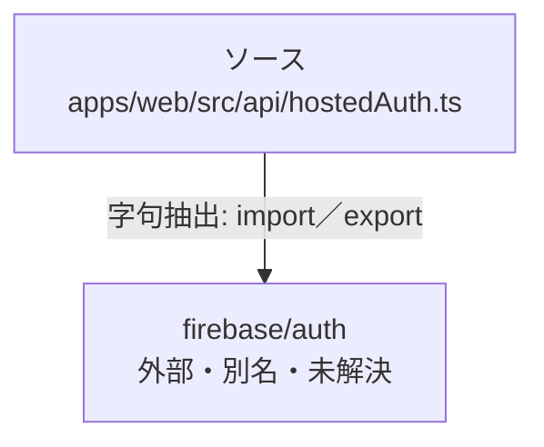

# dependency-map/group-1/n-apps-web-src-api-hostedauth-ts-41fe53

[解析トップへ戻る](../../../README.md)

確認済みファイル: `apps/web/src/api/hostedAuth.ts`

解析: 字句抽出。静的なimport／export参照です。関数の実行順序やHTTP通信は表していません。

宣言: `hostedBrokerAllowed`, `hostedAuth`, `TeamVoiceAccess`, `hostedTokenFetch`

- `firebase/auth` → 外部・標準ライブラリ・別名など。ローカル対応先は未確定

## 要素の説明

### n-firebase-auth-81fd39

参照名: `firebase/auth`

ローカルのソース対応先を確定できませんでした。外部ライブラリ、標準ライブラリ、型別名などを区別する追加確認が必要です。

### source

`apps/web/src/api/hostedAuth.ts` の内容を確認しました。

