# dependency-map/group-1/n-apps-web-src-app-tsx-9064b7/imports-1

[解析トップへ戻る](../../../../README.md)

import参照の表示用グループ。

```mermaid
graph TD
    source["ソース\napps/web/src/App.tsx"]
    n-state-projectworkspace-js-c6e1a1["./state/projectWorkspace.js\napps/web/src/state/projectWorkspace.ts"]
    source -->|"字句抽出: import／export"| n-state-projectworkspace-js-c6e1a1
    n-state-taskworkspace-js-af640b["./state/taskWorkspace.js\napps/web/src/state/taskWorkspace.ts"]
    source -->|"字句抽出: import／export"| n-state-taskworkspace-js-af640b
    n-state-conversationmemory-js-49c47c["./state/conversationMemory.js\napps/web/src/state/conversationMemory.ts"]
    source -->|"字句抽出: import／export"| n-state-conversationmemory-js-49c47c
    n-components-zoomconnection-js-9fdd3f["./components/ZoomConnection.js\napps/web/src/components/ZoomConnection.tsx"]
    source -->|"字句抽出: import／export"| n-components-zoomconnection-js-9fdd3f
    n-react-6b810c["react\n外部・別名・未解決"]
    source -->|"字句抽出: import／export"| n-react-6b810c
    n-api-hostedauth-js-b6f627["./api/hostedAuth.js\napps/web/src/api/hostedAuth.ts"]
    source -->|"字句抽出: import／export"| n-api-hostedauth-js-b6f627
    n-components-screenboundary-js-842717["./components/ScreenBoundary.js\napps/web/src/components/ScreenBoundary.tsx"]
    source -->|"字句抽出: import／export"| n-components-screenboundary-js-842717
    n-rcai-conversation-core-872592["@rcai/conversation-core\n外部・別名・未解決"]
    source -->|"字句抽出: import／export"| n-rcai-conversation-core-872592
```

## 要素の説明

### n-api-hostedauth-js-b6f627

参照名: `./api/hostedAuth.js`

対応する実在ソース: `apps/web/src/api/hostedAuth.ts`。内容確認済み。

### n-components-screenboundary-js-842717

参照名: `./components/ScreenBoundary.js`

対応する実在ソース: `apps/web/src/components/ScreenBoundary.tsx`。内容確認済み。

### n-components-zoomconnection-js-9fdd3f

参照名: `./components/ZoomConnection.js`

対応する実在ソース: `apps/web/src/components/ZoomConnection.tsx`。内容確認済み。

### n-rcai-conversation-core-872592

参照名: `@rcai/conversation-core`

ローカルのソース対応先を確定できませんでした。外部ライブラリ、標準ライブラリ、型別名などを区別する追加確認が必要です。

### n-react-6b810c

参照名: `react`

ローカルのソース対応先を確定できませんでした。外部ライブラリ、標準ライブラリ、型別名などを区別する追加確認が必要です。

### n-state-conversationmemory-js-49c47c

参照名: `./state/conversationMemory.js`

対応する実在ソース: `apps/web/src/state/conversationMemory.ts`。内容確認済み。

### n-state-projectworkspace-js-c6e1a1

参照名: `./state/projectWorkspace.js`

対応する実在ソース: `apps/web/src/state/projectWorkspace.ts`。内容確認済み。

### n-state-taskworkspace-js-af640b

参照名: `./state/taskWorkspace.js`

対応する実在ソース: `apps/web/src/state/taskWorkspace.ts`。内容確認済み。

### source

`apps/web/src/App.tsx` の内容を確認しました。

