# dependency-map/group-1/n-apps-web-src-app-tsx-9064b7/imports-2

[解析トップへ戻る](../../../../README.md)

import参照の表示用グループ。

```mermaid
graph TD
    source["ソース\napps/web/src/App.tsx"]
    n-rcai-persona-core-4ee739["@rcai/persona-core\n外部・別名・未解決"]
    source -->|"字句抽出: import／export"| n-rcai-persona-core-4ee739
    n-api-health-js-ac28d8["./api/health.js\napps/web/src/api/health.ts"]
    source -->|"字句抽出: import／export"| n-api-health-js-ac28d8
    n-components-characters-js-859071["./components/characters.js\napps/web/src/components/characters.ts"]
    source -->|"字句抽出: import／export"| n-components-characters-js-859071
    n-content-fallbackpersonas-js-d7252d["./content/fallbackPersonas.js\napps/web/src/content/fallbackPersonas.ts"]
    source -->|"字句抽出: import／export"| n-content-fallbackpersonas-js-d7252d
    n-integrations-registry-js-914e81["./integrations/registry.js\napps/web/src/integrations/registry.ts"]
    source -->|"字句抽出: import／export"| n-integrations-registry-js-914e81
    n-screens-home-jsx-72d295["./screens/Home.jsx\n外部・別名・未解決"]
    source -->|"字句抽出: import／export"| n-screens-home-jsx-72d295
    n-session-sessioncontroller-js-219df2["./session/SessionController.js\napps/web/src/session/SessionController.ts"]
    source -->|"字句抽出: import／export"| n-session-sessioncontroller-js-219df2
    n-state-settings-js-80f163["./state/settings.js\napps/web/src/state/settings.ts"]
    source -->|"字句抽出: import／export"| n-state-settings-js-80f163
```

## 要素の説明

### n-api-health-js-ac28d8

参照名: `./api/health.js`

対応する実在ソース: `apps/web/src/api/health.ts`。内容確認済み。

### n-components-characters-js-859071

参照名: `./components/characters.js`

対応する実在ソース: `apps/web/src/components/characters.ts`。内容確認済み。

### n-content-fallbackpersonas-js-d7252d

参照名: `./content/fallbackPersonas.js`

対応する実在ソース: `apps/web/src/content/fallbackPersonas.ts`。内容確認済み。

### n-integrations-registry-js-914e81

参照名: `./integrations/registry.js`

対応する実在ソース: `apps/web/src/integrations/registry.ts`。内容確認済み。

### n-rcai-persona-core-4ee739

参照名: `@rcai/persona-core`

ローカルのソース対応先を確定できませんでした。外部ライブラリ、標準ライブラリ、型別名などを区別する追加確認が必要です。

### n-screens-home-jsx-72d295

参照名: `./screens/Home.jsx`

ローカルのソース対応先を確定できませんでした。外部ライブラリ、標準ライブラリ、型別名などを区別する追加確認が必要です。

### n-session-sessioncontroller-js-219df2

参照名: `./session/SessionController.js`

対応する実在ソース: `apps/web/src/session/SessionController.ts`。内容確認済み。

### n-state-settings-js-80f163

参照名: `./state/settings.js`

対応する実在ソース: `apps/web/src/state/settings.ts`。内容は未読。

### source

`apps/web/src/App.tsx` の内容を確認しました。

