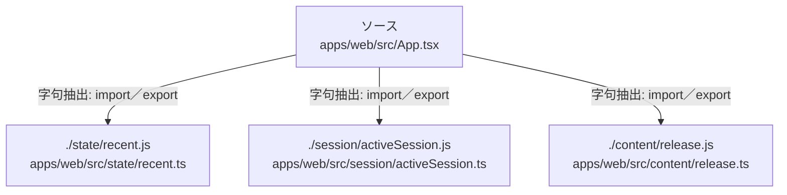

# dependency-map/group-1/n-apps-web-src-app-tsx-9064b7/imports-3

[解析トップへ戻る](../../../../README.md)

import参照の表示用グループ。

## 要素の説明

### n-content-release-js-97e7cf

参照名: `./content/release.js`

対応する実在ソース: `apps/web/src/content/release.ts`。内容は未読。

### n-session-activesession-js-ae1557

参照名: `./session/activeSession.js`

対応する実在ソース: `apps/web/src/session/activeSession.ts`。内容は未読。

### n-state-recent-js-213b04

参照名: `./state/recent.js`

対応する実在ソース: `apps/web/src/state/recent.ts`。内容は未読。

### source

`apps/web/src/App.tsx` の内容を確認しました。

