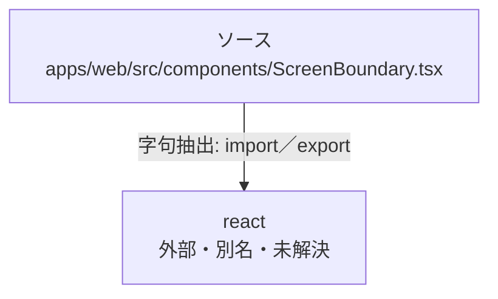

# dependency-map/group-1/n-apps-web-src-components-screenboundary-tsx-d4b5bd

[解析トップへ戻る](../../../README.md)

確認済みファイル: `apps/web/src/components/ScreenBoundary.tsx`

解析: 字句抽出。静的なimport／export参照です。関数の実行順序やHTTP通信は表していません。

宣言: `ScreenBoundaryProps`, `ScreenBoundary`

- `react` → 外部・標準ライブラリ・別名など。ローカル対応先は未確定

## 要素の説明

### n-react-6b810c

参照名: `react`

ローカルのソース対応先を確定できませんでした。外部ライブラリ、標準ライブラリ、型別名などを区別する追加確認が必要です。

### source

`apps/web/src/components/ScreenBoundary.tsx` の内容を確認しました。

