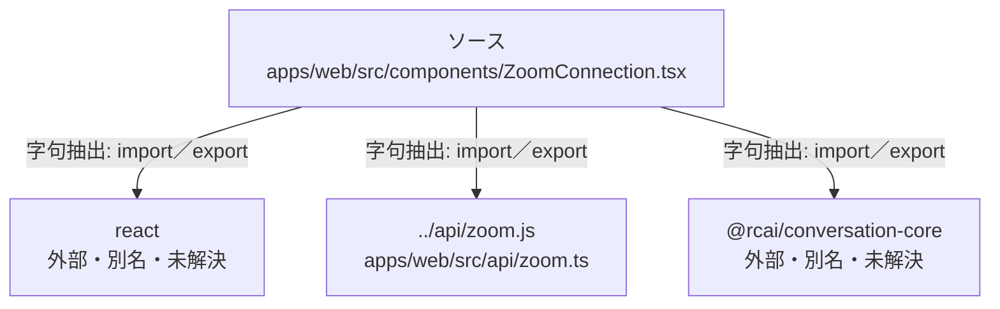

# dependency-map/group-1/n-apps-web-src-components-zoomconnection-tsx-8a83ce

[解析トップへ戻る](../../../README.md)

確認済みファイル: `apps/web/src/components/ZoomConnection.tsx`

解析: 字句抽出。静的なimport／export参照です。関数の実行順序やHTTP通信は表していません。

宣言: `ZoomReturn`, `CloudZoomReturn`, `ZoomConnectionProps`, `ZoomConnection`, `CloudZoomConnection`

- `react` → 外部・標準ライブラリ・別名など。ローカル対応先は未確定
- `../api/zoom.js` → `apps/web/src/api/zoom.ts`（一覧確認・内容未読）
- `@rcai/conversation-core` → 外部・標準ライブラリ・別名など。ローカル対応先は未確定

## 要素の説明

### n-api-zoom-js-5e9d59

参照名: `../api/zoom.js`

対応する実在ソース: `apps/web/src/api/zoom.ts`。内容は未読。

### n-rcai-conversation-core-872592

参照名: `@rcai/conversation-core`

ローカルのソース対応先を確定できませんでした。外部ライブラリ、標準ライブラリ、型別名などを区別する追加確認が必要です。

### n-react-6b810c

参照名: `react`

ローカルのソース対応先を確定できませんでした。外部ライブラリ、標準ライブラリ、型別名などを区別する追加確認が必要です。

### source

`apps/web/src/components/ZoomConnection.tsx` の内容を確認しました。

