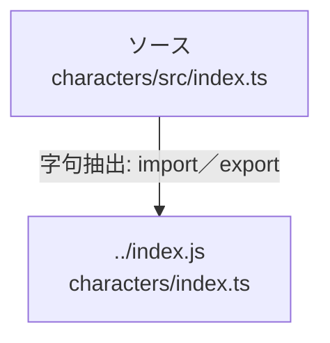

# dependency-map/group-1/n-characters-src-index-ts-69a8eb

[解析トップへ戻る](../../../README.md)

確認済みファイル: `characters/src/index.ts`

解析: 字句抽出。静的なimport／export参照です。関数の実行順序やHTTP通信は表していません。

- `../index.js` → `characters/index.ts`（内容確認済み）

## 要素の説明

### n-index-js-02e9bf

参照名: `../index.js`

対応する実在ソース: `characters/index.ts`。内容確認済み。

### source

`characters/src/index.ts` の内容を確認しました。

