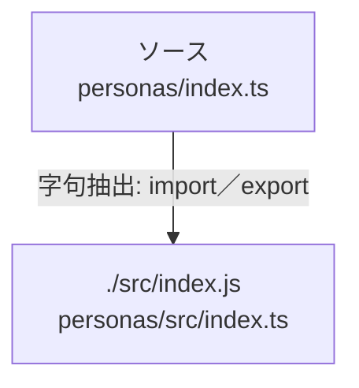

# dependency-map/group-1/n-personas-index-ts-4ce565

[解析トップへ戻る](../../../README.md)

確認済みファイル: `personas/index.ts`

解析: 字句抽出。静的なimport／export参照です。関数の実行順序やHTTP通信は表していません。

- `./src/index.js` → `personas/src/index.ts`（内容確認済み）

## 要素の説明

### n-src-index-js-d4a304

参照名: `./src/index.js`

対応する実在ソース: `personas/src/index.ts`。内容確認済み。

### source

`personas/index.ts` の内容を確認しました。

