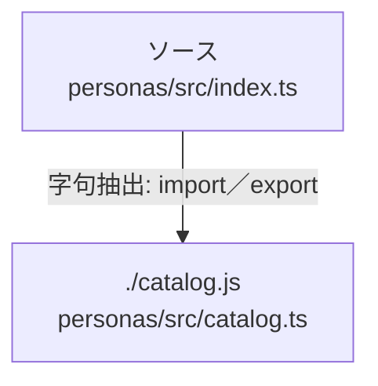

# dependency-map/group-1/n-personas-src-index-ts-bd7ec3

[解析トップへ戻る](../../../README.md)

確認済みファイル: `personas/src/index.ts`

解析: 字句抽出。静的なimport／export参照です。関数の実行順序やHTTP通信は表していません。

- `./catalog.js` → `personas/src/catalog.ts`（一覧確認・内容未読）

## 要素の説明

### n-catalog-js-cfbf4f

参照名: `./catalog.js`

対応する実在ソース: `personas/src/catalog.ts`。内容は未読。

### source

`personas/src/index.ts` の内容を確認しました。

