# dependency-map/group-2

[解析トップへ戻る](../../README.md)

このグループは表示用の区切りです。独立した実行モジュールではありません。

```mermaid
graph TD
    n-apps-web-src-api-health-ts-42fa84["health.ts\napps/web/src/api/health.ts"]
    n-apps-web-src-components-characters-ts-b124c7["characters.ts\napps/web/src/components/characters.ts"]
    n-apps-web-src-content-fallbackpersonas-ts-ff412c["fallbackPersonas.ts\napps/web/src/content/fallbackPersonas.ts"]
    n-apps-web-src-integrations-registry-ts-466c56["registry.ts\napps/web/src/integrations/registry.ts"]
    n-apps-web-src-session-sessioncontroller-ts-de1553["SessionController.ts\napps/web/src/session/SessionController.ts"]
    n-apps-web-src-main-tsx-3b90b8["main.tsx\napps/web/src/main.tsx"]
```

## 要素の説明

### n-apps-web-src-api-health-ts-42fa84

確認済みファイル: `apps/web/src/api/health.ts`

解析: 字句抽出。静的なimport／export参照です。関数の実行順序やHTTP通信は表していません。

宣言: `BrokerHealth`, `AgentHealth`, `agentHttpUrl`, `getJson`, `isLoopbackUrl`, `shouldProbeLocalAgent`, `probe`, `readError`

- `../state/settings.js` → `apps/web/src/state/settings.ts`（一覧確認・内容未読）

[詳細な図と説明を見る](n-apps-web-src-api-health-ts-42fa84/README.md)

### n-apps-web-src-components-characters-ts-b124c7

確認済みファイル: `apps/web/src/components/characters.ts`

解析: 字句抽出。静的なimport／export参照です。関数の実行順序やHTTP通信は表していません。

宣言: `withRealistic`, `blockedReason`

- `../api/health.js` → `apps/web/src/api/health.ts`（内容確認済み）
- `../integrations/registry.js` → `apps/web/src/integrations/registry.ts`（内容確認済み）

[詳細な図と説明を見る](n-apps-web-src-components-characters-ts-b124c7/README.md)

### n-apps-web-src-content-fallbackpersonas-ts-ff412c

確認済みファイル: `apps/web/src/content/fallbackPersonas.ts`

解析: 字句抽出。静的なimport／export参照です。関数の実行順序やHTTP通信は表していません。

- `@rcai/persona-core` → 外部・標準ライブラリ・別名など。ローカル対応先は未確定

[詳細な図と説明を見る](n-apps-web-src-content-fallbackpersonas-ts-ff412c/README.md)

### n-apps-web-src-integrations-registry-ts-466c56

確認済みファイル: `apps/web/src/integrations/registry.ts`

解析: 字句抽出。静的なimport／export参照です。関数の実行順序やHTTP通信は表していません。

宣言: `IntegrationMissingError`, `pick`, `ProviderFactoryOptions`, `createConversationProvider`, `createEvaluator`, `createHeuristicEvaluator`, `AvatarFactoryOptions`, `avatarCapabilities`, `webglAvailable`, `createAvatarProvider`, `CharacterEntry`, `loadCharacterEntries`, `loadPersonas`, `plannerUrl`, `MeetingFactoryOptions`, `createMeetingConnector`

- `../api/zoom.js` → `apps/web/src/api/zoom.ts`（一覧確認・内容未読）
- `../api/hostedAuth.js` → `apps/web/src/api/hostedAuth.ts`（内容確認済み）
- `./localAvatarFallback.js` → `apps/web/src/integrations/localAvatarFallback.ts`（一覧確認・内容未読）
- `@rcai/conversation-core` → 外部・標準ライブラリ・別名など。ローカル対応先は未確定
- `@rcai/provider-core` → 外部・標準ライブラリ・別名など。ローカル対応先は未確定
- `@rcai/avatar-core` → 外部・標準ライブラリ・別名など。ローカル対応先は未確定
- `@rcai/persona-core` → 外部・標準ライブラリ・別名など。ローカル対応先は未確定
- `../api/health.js` → `apps/web/src/api/health.ts`（内容確認済み）

[詳細な図と説明を見る](n-apps-web-src-integrations-registry-ts-466c56/README.md)

### n-apps-web-src-main-tsx-3b90b8

確認済みファイル: `apps/web/src/main.tsx`

解析: 字句抽出。静的なimport／export参照です。関数の実行順序やHTTP通信は表していません。

- `react` → 外部・標準ライブラリ・別名など。ローカル対応先は未確定
- `react-dom/client` → 外部・標準ライブラリ・別名など。ローカル対応先は未確定
- `./App.jsx` → 外部・標準ライブラリ・別名など。ローカル対応先は未確定
- `./styles/global.css` → `apps/web/src/styles/global.css`（一覧確認・内容未読）
- `./styles/workspace.css` → `apps/web/src/styles/workspace.css`（一覧確認・内容未読）
- `./styles/quiet-cinema.css` → `apps/web/src/styles/quiet-cinema.css`（一覧確認・内容未読）
- `./audio/debugRegistry.js` → `apps/web/src/audio/debugRegistry.ts`（一覧確認・内容未読）

[詳細な図と説明を見る](n-apps-web-src-main-tsx-3b90b8/README.md)

### n-apps-web-src-session-sessioncontroller-ts-de1553

確認済みファイル: `apps/web/src/session/SessionController.ts`

解析: 字句抽出。静的なimport／export参照です。関数の実行順序やHTTP通信は表していません。

宣言: `SessionDisposedError`, `SessionHandlers`, `SessionInit`, `SessionOutcome`, `SessionController`

- `./lateAvatar.js` → `apps/web/src/session/lateAvatar.ts`（一覧確認・内容未読）
- `./voiceActivity.js` → `apps/web/src/session/voiceActivity.ts`（一覧確認・内容未読）
- `./sessionTools.js` → `apps/web/src/session/sessionTools.ts`（一覧確認・内容未読）
- `../state/taskWorkspace.js` → `apps/web/src/state/taskWorkspace.ts`（内容確認済み）
- `@rcai/conversation-core` → 外部・標準ライブラリ・別名など。ローカル対応先は未確定
- `@rcai/meeting-core` → 外部・標準ライブラリ・別名など。ローカル対応先は未確定
- `@rcai/audio-core` → 外部・標準ライブラリ・別名など。ローカル対応先は未確定
- `@rcai/provider-core` → 外部・標準ライブラリ・別名など。ローカル対応先は未確定
- `@rcai/avatar-core` → 外部・標準ライブラリ・別名など。ローカル対応先は未確定
- `@rcai/behavior-engine` → 外部・標準ライブラリ・別名など。ローカル対応先は未確定
- `@rcai/persona-core` → 外部・標準ライブラリ・別名など。ローカル対応先は未確定
- `../integrations/registry.js` → `apps/web/src/integrations/registry.ts`（内容確認済み）
- `../state/settings.js` → `apps/web/src/state/settings.ts`（一覧確認・内容未読）
- `./sidecar.js` → `apps/web/src/session/sidecar.ts`（一覧確認・内容未読）
- `@rcai/observability` → 外部・標準ライブラリ・別名など。ローカル対応先は未確定
- `./IncidentRecorder.js` → `apps/web/src/session/IncidentRecorder.ts`（一覧確認・内容未読）
- `./activeSession.js` → `apps/web/src/session/activeSession.ts`（一覧確認・内容未読）

[詳細な図と説明を見る](n-apps-web-src-session-sessioncontroller-ts-de1553/README.md)

