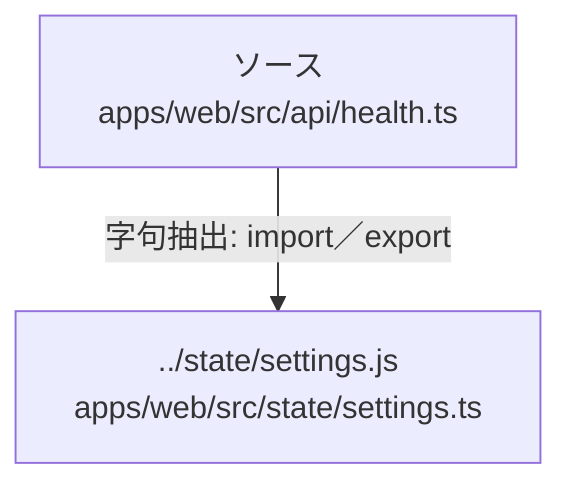

# dependency-map/group-2/n-apps-web-src-api-health-ts-42fa84

[解析トップへ戻る](../../../README.md)

確認済みファイル: `apps/web/src/api/health.ts`

解析: 字句抽出。静的なimport／export参照です。関数の実行順序やHTTP通信は表していません。

宣言: `BrokerHealth`, `AgentHealth`, `agentHttpUrl`, `getJson`, `isLoopbackUrl`, `shouldProbeLocalAgent`, `probe`, `readError`

- `../state/settings.js` → `apps/web/src/state/settings.ts`（一覧確認・内容未読）

## 要素の説明

### n-state-settings-js-15ac8d

参照名: `../state/settings.js`

対応する実在ソース: `apps/web/src/state/settings.ts`。内容は未読。

### source

`apps/web/src/api/health.ts` の内容を確認しました。

