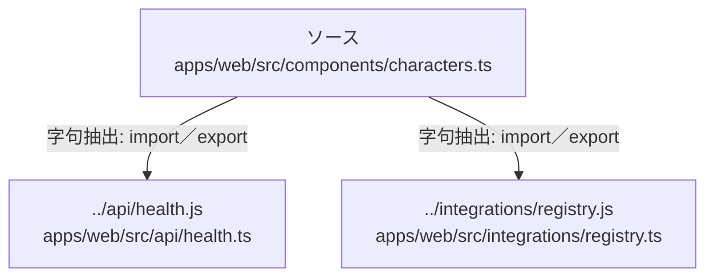

# dependency-map/group-2/n-apps-web-src-components-characters-ts-b124c7

[解析トップへ戻る](../../../README.md)

確認済みファイル: `apps/web/src/components/characters.ts`

解析: 字句抽出。静的なimport／export参照です。関数の実行順序やHTTP通信は表していません。

宣言: `withRealistic`, `blockedReason`

- `../api/health.js` → `apps/web/src/api/health.ts`（内容確認済み）
- `../integrations/registry.js` → `apps/web/src/integrations/registry.ts`（内容確認済み）

## 要素の説明

### n-api-health-js-6829ac

参照名: `../api/health.js`

対応する実在ソース: `apps/web/src/api/health.ts`。内容確認済み。

### n-integrations-registry-js-38c7d9

参照名: `../integrations/registry.js`

対応する実在ソース: `apps/web/src/integrations/registry.ts`。内容確認済み。

### source

`apps/web/src/components/characters.ts` の内容を確認しました。

