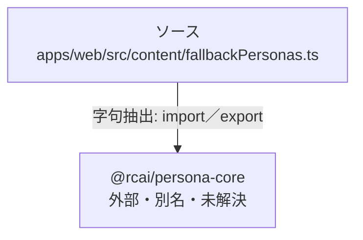

# dependency-map/group-2/n-apps-web-src-content-fallbackpersonas-ts-ff412c

[解析トップへ戻る](../../../README.md)

確認済みファイル: `apps/web/src/content/fallbackPersonas.ts`

解析: 字句抽出。静的なimport／export参照です。関数の実行順序やHTTP通信は表していません。

- `@rcai/persona-core` → 外部・標準ライブラリ・別名など。ローカル対応先は未確定

## 要素の説明

### n-rcai-persona-core-4ee739

参照名: `@rcai/persona-core`

ローカルのソース対応先を確定できませんでした。外部ライブラリ、標準ライブラリ、型別名などを区別する追加確認が必要です。

### source

`apps/web/src/content/fallbackPersonas.ts` の内容を確認しました。

