# dependency-map/group-2/n-apps-web-src-integrations-registry-ts-466c56

[解析トップへ戻る](../../../README.md)

確認済みファイル: `apps/web/src/integrations/registry.ts`

解析: 字句抽出。静的なimport／export参照です。関数の実行順序やHTTP通信は表していません。

宣言: `IntegrationMissingError`, `pick`, `ProviderFactoryOptions`, `createConversationProvider`, `createEvaluator`, `createHeuristicEvaluator`, `AvatarFactoryOptions`, `avatarCapabilities`, `webglAvailable`, `createAvatarProvider`, `CharacterEntry`, `loadCharacterEntries`, `loadPersonas`, `plannerUrl`, `MeetingFactoryOptions`, `createMeetingConnector`

- `../api/zoom.js` → `apps/web/src/api/zoom.ts`（一覧確認・内容未読）
- `../api/hostedAuth.js` → `apps/web/src/api/hostedAuth.ts`（内容確認済み）
- `./localAvatarFallback.js` → `apps/web/src/integrations/localAvatarFallback.ts`（一覧確認・内容未読）
- `@rcai/conversation-core` → 外部・標準ライブラリ・別名など。ローカル対応先は未確定
- `@rcai/provider-core` → 外部・標準ライブラリ・別名など。ローカル対応先は未確定
- `@rcai/avatar-core` → 外部・標準ライブラリ・別名など。ローカル対応先は未確定
- `@rcai/persona-core` → 外部・標準ライブラリ・別名など。ローカル対応先は未確定
- `../api/health.js` → `apps/web/src/api/health.ts`（内容確認済み）

```mermaid
graph TD
    source["ソース\napps/web/src/integrations/registry.ts"]
    n-api-zoom-js-5e9d59["../api/zoom.js\napps/web/src/api/zoom.ts"]
    source -->|"字句抽出: import／export"| n-api-zoom-js-5e9d59
    n-api-hostedauth-js-4f0384["../api/hostedAuth.js\napps/web/src/api/hostedAuth.ts"]
    source -->|"字句抽出: import／export"| n-api-hostedauth-js-4f0384
    n-localavatarfallback-js-fe08a7["./localAvatarFallback.js\napps/web/src/integrations/localAvatarFallback.ts"]
    source -->|"字句抽出: import／export"| n-localavatarfallback-js-fe08a7
    n-rcai-conversation-core-872592["@rcai/conversation-core\n外部・別名・未解決"]
    source -->|"字句抽出: import／export"| n-rcai-conversation-core-872592
    n-rcai-provider-core-507286["@rcai/provider-core\n外部・別名・未解決"]
    source -->|"字句抽出: import／export"| n-rcai-provider-core-507286
    n-rcai-avatar-core-03b916["@rcai/avatar-core\n外部・別名・未解決"]
    source -->|"字句抽出: import／export"| n-rcai-avatar-core-03b916
    n-rcai-persona-core-4ee739["@rcai/persona-core\n外部・別名・未解決"]
    source -->|"字句抽出: import／export"| n-rcai-persona-core-4ee739
    n-api-health-js-6829ac["../api/health.js\napps/web/src/api/health.ts"]
    source -->|"字句抽出: import／export"| n-api-health-js-6829ac
```

## 要素の説明

### n-api-health-js-6829ac

参照名: `../api/health.js`

対応する実在ソース: `apps/web/src/api/health.ts`。内容確認済み。

### n-api-hostedauth-js-4f0384

参照名: `../api/hostedAuth.js`

対応する実在ソース: `apps/web/src/api/hostedAuth.ts`。内容確認済み。

### n-api-zoom-js-5e9d59

参照名: `../api/zoom.js`

対応する実在ソース: `apps/web/src/api/zoom.ts`。内容は未読。

### n-localavatarfallback-js-fe08a7

参照名: `./localAvatarFallback.js`

対応する実在ソース: `apps/web/src/integrations/localAvatarFallback.ts`。内容は未読。

### n-rcai-avatar-core-03b916

参照名: `@rcai/avatar-core`

ローカルのソース対応先を確定できませんでした。外部ライブラリ、標準ライブラリ、型別名などを区別する追加確認が必要です。

### n-rcai-conversation-core-872592

参照名: `@rcai/conversation-core`

ローカルのソース対応先を確定できませんでした。外部ライブラリ、標準ライブラリ、型別名などを区別する追加確認が必要です。

### n-rcai-persona-core-4ee739

参照名: `@rcai/persona-core`

ローカルのソース対応先を確定できませんでした。外部ライブラリ、標準ライブラリ、型別名などを区別する追加確認が必要です。

### n-rcai-provider-core-507286

参照名: `@rcai/provider-core`

ローカルのソース対応先を確定できませんでした。外部ライブラリ、標準ライブラリ、型別名などを区別する追加確認が必要です。

### source

`apps/web/src/integrations/registry.ts` の内容を確認しました。

