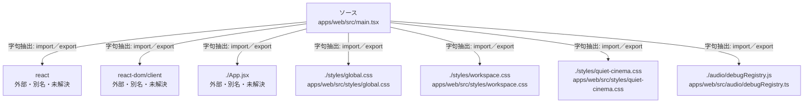

# dependency-map/group-2/n-apps-web-src-main-tsx-3b90b8

[解析トップへ戻る](../../../README.md)

確認済みファイル: `apps/web/src/main.tsx`

解析: 字句抽出。静的なimport／export参照です。関数の実行順序やHTTP通信は表していません。

- `react` → 外部・標準ライブラリ・別名など。ローカル対応先は未確定
- `react-dom/client` → 外部・標準ライブラリ・別名など。ローカル対応先は未確定
- `./App.jsx` → 外部・標準ライブラリ・別名など。ローカル対応先は未確定
- `./styles/global.css` → `apps/web/src/styles/global.css`（一覧確認・内容未読）
- `./styles/workspace.css` → `apps/web/src/styles/workspace.css`（一覧確認・内容未読）
- `./styles/quiet-cinema.css` → `apps/web/src/styles/quiet-cinema.css`（一覧確認・内容未読）
- `./audio/debugRegistry.js` → `apps/web/src/audio/debugRegistry.ts`（一覧確認・内容未読）

## 要素の説明

### n-app-jsx-3c3828

参照名: `./App.jsx`

ローカルのソース対応先を確定できませんでした。外部ライブラリ、標準ライブラリ、型別名などを区別する追加確認が必要です。

### n-audio-debugregistry-js-afd984

参照名: `./audio/debugRegistry.js`

対応する実在ソース: `apps/web/src/audio/debugRegistry.ts`。内容は未読。

### n-react-6b810c

参照名: `react`

ローカルのソース対応先を確定できませんでした。外部ライブラリ、標準ライブラリ、型別名などを区別する追加確認が必要です。

### n-react-dom-client-bcbcc9

参照名: `react-dom/client`

ローカルのソース対応先を確定できませんでした。外部ライブラリ、標準ライブラリ、型別名などを区別する追加確認が必要です。

### n-styles-global-css-ad3884

参照名: `./styles/global.css`

対応する実在ソース: `apps/web/src/styles/global.css`。内容は未読。

### n-styles-quiet-cinema-css-215eab

参照名: `./styles/quiet-cinema.css`

対応する実在ソース: `apps/web/src/styles/quiet-cinema.css`。内容は未読。

### n-styles-workspace-css-1a4de9

参照名: `./styles/workspace.css`

対応する実在ソース: `apps/web/src/styles/workspace.css`。内容は未読。

### source

`apps/web/src/main.tsx` の内容を確認しました。

