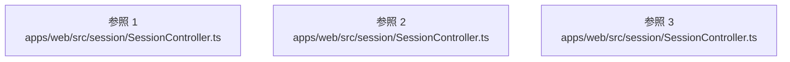

# dependency-map/group-2/n-apps-web-src-session-sessioncontroller-ts-de1553

[解析トップへ戻る](../../../README.md)

確認済みファイル: `apps/web/src/session/SessionController.ts`

解析: 字句抽出。静的なimport／export参照です。関数の実行順序やHTTP通信は表していません。

宣言: `SessionDisposedError`, `SessionHandlers`, `SessionInit`, `SessionOutcome`, `SessionController`

- `./lateAvatar.js` → `apps/web/src/session/lateAvatar.ts`（一覧確認・内容未読）
- `./voiceActivity.js` → `apps/web/src/session/voiceActivity.ts`（一覧確認・内容未読）
- `./sessionTools.js` → `apps/web/src/session/sessionTools.ts`（一覧確認・内容未読）
- `../state/taskWorkspace.js` → `apps/web/src/state/taskWorkspace.ts`（内容確認済み）
- `@rcai/conversation-core` → 外部・標準ライブラリ・別名など。ローカル対応先は未確定
- `@rcai/meeting-core` → 外部・標準ライブラリ・別名など。ローカル対応先は未確定
- `@rcai/audio-core` → 外部・標準ライブラリ・別名など。ローカル対応先は未確定
- `@rcai/provider-core` → 外部・標準ライブラリ・別名など。ローカル対応先は未確定
- `@rcai/avatar-core` → 外部・標準ライブラリ・別名など。ローカル対応先は未確定
- `@rcai/behavior-engine` → 外部・標準ライブラリ・別名など。ローカル対応先は未確定
- `@rcai/persona-core` → 外部・標準ライブラリ・別名など。ローカル対応先は未確定
- `../integrations/registry.js` → `apps/web/src/integrations/registry.ts`（内容確認済み）
- `../state/settings.js` → `apps/web/src/state/settings.ts`（一覧確認・内容未読）
- `./sidecar.js` → `apps/web/src/session/sidecar.ts`（一覧確認・内容未読）
- `@rcai/observability` → 外部・標準ライブラリ・別名など。ローカル対応先は未確定
- `./IncidentRecorder.js` → `apps/web/src/session/IncidentRecorder.ts`（一覧確認・内容未読）
- `./activeSession.js` → `apps/web/src/session/activeSession.ts`（一覧確認・内容未読）

## 要素の説明

### imports-1

import参照の表示用グループ。

[詳細な図と説明を見る](imports-1/README.md)

### imports-2

import参照の表示用グループ。

[詳細な図と説明を見る](imports-2/README.md)

### imports-3

import参照の表示用グループ。

[詳細な図と説明を見る](imports-3/README.md)

