# dependency-map/group-2/n-apps-web-src-session-sessioncontroller-ts-de1553/imports-1

[解析トップへ戻る](../../../../README.md)

import参照の表示用グループ。

```mermaid
graph TD
    source["ソース\napps/web/src/session/SessionController.ts"]
    n-lateavatar-js-81b55e["./lateAvatar.js\napps/web/src/session/lateAvatar.ts"]
    source -->|"字句抽出: import／export"| n-lateavatar-js-81b55e
    n-voiceactivity-js-42f164["./voiceActivity.js\napps/web/src/session/voiceActivity.ts"]
    source -->|"字句抽出: import／export"| n-voiceactivity-js-42f164
    n-sessiontools-js-23e2fb["./sessionTools.js\napps/web/src/session/sessionTools.ts"]
    source -->|"字句抽出: import／export"| n-sessiontools-js-23e2fb
    n-state-taskworkspace-js-4a8449["../state/taskWorkspace.js\napps/web/src/state/taskWorkspace.ts"]
    source -->|"字句抽出: import／export"| n-state-taskworkspace-js-4a8449
    n-rcai-conversation-core-872592["@rcai/conversation-core\n外部・別名・未解決"]
    source -->|"字句抽出: import／export"| n-rcai-conversation-core-872592
    n-rcai-meeting-core-34712a["@rcai/meeting-core\n外部・別名・未解決"]
    source -->|"字句抽出: import／export"| n-rcai-meeting-core-34712a
    n-rcai-audio-core-453334["@rcai/audio-core\n外部・別名・未解決"]
    source -->|"字句抽出: import／export"| n-rcai-audio-core-453334
    n-rcai-provider-core-507286["@rcai/provider-core\n外部・別名・未解決"]
    source -->|"字句抽出: import／export"| n-rcai-provider-core-507286
```

## 要素の説明

### n-lateavatar-js-81b55e

参照名: `./lateAvatar.js`

対応する実在ソース: `apps/web/src/session/lateAvatar.ts`。内容は未読。

### n-rcai-audio-core-453334

参照名: `@rcai/audio-core`

ローカルのソース対応先を確定できませんでした。外部ライブラリ、標準ライブラリ、型別名などを区別する追加確認が必要です。

### n-rcai-conversation-core-872592

参照名: `@rcai/conversation-core`

ローカルのソース対応先を確定できませんでした。外部ライブラリ、標準ライブラリ、型別名などを区別する追加確認が必要です。

### n-rcai-meeting-core-34712a

参照名: `@rcai/meeting-core`

ローカルのソース対応先を確定できませんでした。外部ライブラリ、標準ライブラリ、型別名などを区別する追加確認が必要です。

### n-rcai-provider-core-507286

参照名: `@rcai/provider-core`

ローカルのソース対応先を確定できませんでした。外部ライブラリ、標準ライブラリ、型別名などを区別する追加確認が必要です。

### n-sessiontools-js-23e2fb

参照名: `./sessionTools.js`

対応する実在ソース: `apps/web/src/session/sessionTools.ts`。内容は未読。

### n-state-taskworkspace-js-4a8449

参照名: `../state/taskWorkspace.js`

対応する実在ソース: `apps/web/src/state/taskWorkspace.ts`。内容確認済み。

### n-voiceactivity-js-42f164

参照名: `./voiceActivity.js`

対応する実在ソース: `apps/web/src/session/voiceActivity.ts`。内容は未読。

### source

`apps/web/src/session/SessionController.ts` の内容を確認しました。

