# dependency-map/group-2/n-apps-web-src-session-sessioncontroller-ts-de1553/imports-2

[解析トップへ戻る](../../../../README.md)

import参照の表示用グループ。

```mermaid
graph TD
    source["ソース\napps/web/src/session/SessionController.ts"]
    n-rcai-avatar-core-03b916["@rcai/avatar-core\n外部・別名・未解決"]
    source -->|"字句抽出: import／export"| n-rcai-avatar-core-03b916
    n-rcai-behavior-engine-555a34["@rcai/behavior-engine\n外部・別名・未解決"]
    source -->|"字句抽出: import／export"| n-rcai-behavior-engine-555a34
    n-rcai-persona-core-4ee739["@rcai/persona-core\n外部・別名・未解決"]
    source -->|"字句抽出: import／export"| n-rcai-persona-core-4ee739
    n-integrations-registry-js-38c7d9["../integrations/registry.js\napps/web/src/integrations/registry.ts"]
    source -->|"字句抽出: import／export"| n-integrations-registry-js-38c7d9
    n-state-settings-js-15ac8d["../state/settings.js\napps/web/src/state/settings.ts"]
    source -->|"字句抽出: import／export"| n-state-settings-js-15ac8d
    n-sidecar-js-67b06e["./sidecar.js\napps/web/src/session/sidecar.ts"]
    source -->|"字句抽出: import／export"| n-sidecar-js-67b06e
    n-rcai-observability-cf8cce["@rcai/observability\n外部・別名・未解決"]
    source -->|"字句抽出: import／export"| n-rcai-observability-cf8cce
    n-incidentrecorder-js-b00dbe["./IncidentRecorder.js\napps/web/src/session/IncidentRecorder.ts"]
    source -->|"字句抽出: import／export"| n-incidentrecorder-js-b00dbe
```

## 要素の説明

### n-incidentrecorder-js-b00dbe

参照名: `./IncidentRecorder.js`

対応する実在ソース: `apps/web/src/session/IncidentRecorder.ts`。内容は未読。

### n-integrations-registry-js-38c7d9

参照名: `../integrations/registry.js`

対応する実在ソース: `apps/web/src/integrations/registry.ts`。内容確認済み。

### n-rcai-avatar-core-03b916

参照名: `@rcai/avatar-core`

ローカルのソース対応先を確定できませんでした。外部ライブラリ、標準ライブラリ、型別名などを区別する追加確認が必要です。

### n-rcai-behavior-engine-555a34

参照名: `@rcai/behavior-engine`

ローカルのソース対応先を確定できませんでした。外部ライブラリ、標準ライブラリ、型別名などを区別する追加確認が必要です。

### n-rcai-observability-cf8cce

参照名: `@rcai/observability`

ローカルのソース対応先を確定できませんでした。外部ライブラリ、標準ライブラリ、型別名などを区別する追加確認が必要です。

### n-rcai-persona-core-4ee739

参照名: `@rcai/persona-core`

ローカルのソース対応先を確定できませんでした。外部ライブラリ、標準ライブラリ、型別名などを区別する追加確認が必要です。

### n-sidecar-js-67b06e

参照名: `./sidecar.js`

対応する実在ソース: `apps/web/src/session/sidecar.ts`。内容は未読。

### n-state-settings-js-15ac8d

参照名: `../state/settings.js`

対応する実在ソース: `apps/web/src/state/settings.ts`。内容は未読。

### source

`apps/web/src/session/SessionController.ts` の内容を確認しました。

