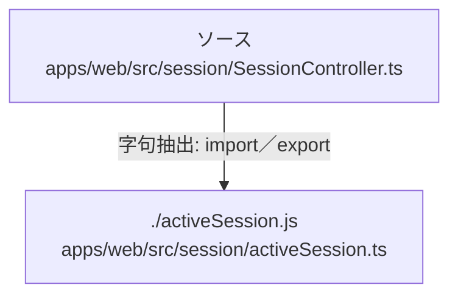

# dependency-map/group-2/n-apps-web-src-session-sessioncontroller-ts-de1553/imports-3

[解析トップへ戻る](../../../../README.md)

import参照の表示用グループ。

## 要素の説明

### n-activesession-js-afb8c3

参照名: `./activeSession.js`

対応する実在ソース: `apps/web/src/session/activeSession.ts`。内容は未読。

### source

`apps/web/src/session/SessionController.ts` の内容を確認しました。

