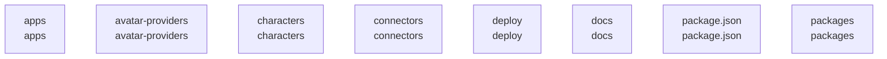

# overall-architecture/group-1

[解析トップへ戻る](../../README.md)

このグループは表示用の区切りです。独立した実行モジュールではありません。

## 要素の説明

### n-apps-802508

確認したパス: `apps`。配下の登録ファイルは202件。

- `apps/desktop/README.md`（一覧のみ）
- `apps/desktop/local-runtime/models.json`（一覧のみ）
- `apps/desktop/local-runtime/node-entitlements.plist`（一覧のみ）
- `apps/desktop/local-runtime/setup.mjs`（一覧のみ）
- `apps/desktop/local-runtime/setup.test.mjs`（一覧のみ）
- `apps/desktop/package.json`（内容確認済み）
- `apps/desktop/src-tauri/Cargo.lock`（一覧のみ）
- `apps/desktop/src-tauri/Cargo.toml`（一覧のみ）
- `apps/desktop/src-tauri/Entitlements.plist`（一覧のみ）
- `apps/desktop/src-tauri/Info.plist`（一覧のみ）
- `apps/desktop/src-tauri/build.rs`（一覧のみ）
- `apps/desktop/src-tauri/capabilities/default.json`（一覧のみ）
- `apps/desktop/src-tauri/icons/icon.icns`（一覧のみ）
- `apps/desktop/src-tauri/icons/icon.png`（一覧のみ）
- `apps/desktop/src-tauri/src/lib.rs`（一覧のみ）
- `apps/desktop/src-tauri/src/local_setup.rs`（一覧のみ）
- `apps/desktop/src-tauri/src/main.rs`（一覧のみ）
- `apps/desktop/src-tauri/tauri.conf.json`（一覧のみ）
- `apps/web/.env.example`（一覧のみ）
- `apps/web/index.html`（一覧のみ）
- `apps/web/orb-preview.html`（一覧のみ）
- `apps/web/package.json`（内容確認済み）
- `apps/web/public/agent/runtime/index.html`（一覧のみ）
- `apps/web/public/avatar-fallbacks/sora.png`（一覧のみ）
- `apps/web/public/characters`（一覧のみ）
- `apps/web/public/demo/SOURCE.md`（一覧のみ）
- `apps/web/public/demo/voice-sample.m4a`（一覧のみ）
- `apps/web/public/icon.svg`（一覧のみ）
- `apps/web/public/robots.txt`（一覧のみ）
- `apps/web/public/sitemap.xml`（一覧のみ）
- `apps/web/public/vendor`（一覧のみ）
- `apps/web/scripts/acoustic-gate.mjs`（一覧のみ）
- `apps/web/scripts/e2e-browser.mjs`（一覧のみ）
- `apps/web/scripts/lib/make-soak-wav.mjs`（一覧のみ）
- `apps/web/scripts/lifecycle-stress.mjs`（一覧のみ）

[詳細な図と説明を見る](n-apps-802508/README.md)

### n-avatar-providers-40c65d

確認したパス: `avatar-providers`。配下の登録ファイルは68件。

- `avatar-providers/anam/README.md`（一覧のみ）
- `avatar-providers/anam/package.json`（内容確認済み）
- `avatar-providers/anam/src/AnamAvatarProvider.ts`（一覧のみ）
- `avatar-providers/anam/src/anam.test.ts`（一覧のみ）
- `avatar-providers/anam/src/index.ts`（一覧のみ）
- `avatar-providers/anam/tsconfig.json`（一覧のみ）
- `avatar-providers/canvas/README.md`（一覧のみ）
- `avatar-providers/canvas/package.json`（内容確認済み）
- `avatar-providers/canvas/src/canvas.test.ts`（一覧のみ）
- `avatar-providers/canvas/src/canvasAvatar.ts`（一覧のみ）
- `avatar-providers/canvas/src/index.ts`（一覧のみ）
- `avatar-providers/canvas/tsconfig.json`（一覧のみ）
- `avatar-providers/live2d/README.md`（一覧のみ）
- `avatar-providers/live2d/demo/ab-main.ts`（一覧のみ）
- `avatar-providers/live2d/demo/ab-run.mjs`（一覧のみ）
- `avatar-providers/live2d/demo/ab.html`（一覧のみ）
- `avatar-providers/live2d/demo/index.html`（一覧のみ）
- `avatar-providers/live2d/demo/main.ts`（一覧のみ）
- `avatar-providers/live2d/demo/verify.mjs`（一覧のみ）
- `avatar-providers/live2d/demo/vite.config.ts`（一覧のみ）
- `avatar-providers/live2d/package.json`（内容確認済み）
- `avatar-providers/live2d/src/core.ts`（一覧のみ）
- `avatar-providers/live2d/src/index.ts`（一覧のみ）
- `avatar-providers/live2d/src/live2d.test.ts`（一覧のみ）
- `avatar-providers/live2d/src/live2dAvatar.ts`（一覧のみ）
- `avatar-providers/live2d/src/mapping.ts`（一覧のみ）
- `avatar-providers/live2d/src/motionSync.ts`（一覧のみ）
- `avatar-providers/live2d/src/motionsync.test.ts`（一覧のみ）
- `avatar-providers/live2d/src/motionsync/coreApi.ts`（一覧のみ）
- `avatar-providers/live2d/src/motionsync/cubismMotionSync.ts`（一覧のみ）
- `avatar-providers/live2d/src/motionsync/data.ts`（一覧のみ）
- `avatar-providers/live2d/src/motionsync/engine.ts`（一覧のみ）
- `avatar-providers/live2d/src/motionsync/index.ts`（一覧のみ）
- `avatar-providers/live2d/tsconfig.json`（一覧のみ）
- `avatar-providers/liveavatar/README.md`（一覧のみ）

[詳細な図と説明を見る](n-avatar-providers-40c65d/README.md)

### n-characters-aa908a

確認したパス: `characters`。配下の登録ファイルは34件。

- `characters/.gitignore`（一覧のみ）
- `characters/characters.test.ts`（一覧のみ）
- `characters/haru/character.json`（一覧のみ）
- `characters/haru/manifest.json`（一覧のみ）
- `characters/haru/model/README.md`（一覧のみ）
- `characters/index.ts`（内容確認済み）
- `characters/kei/character.json`（一覧のみ）
- `characters/kei/manifest.json`（一覧のみ）
- `characters/kei/model/README.md`（一覧のみ）
- `characters/package.json`（一覧のみ）
- `characters/reina/character.json`（一覧のみ）
- `characters/reina/manifest.json`（一覧のみ）
- `characters/reina/model/README.md`（一覧のみ）
- `characters/sora/LICENSE.md`（一覧のみ）
- `characters/sora/SOURCE.json`（一覧のみ）
- `characters/sora/character.json`（一覧のみ）
- `characters/sora/manifest.json`（一覧のみ）
- `characters/sora/model.glb`（一覧のみ）
- `characters/src/index.ts`（内容確認済み）
- `characters/tsconfig.json`（一覧のみ）
- `characters/vrm-sample/LICENSE.md`（一覧のみ）
- `characters/vrm-sample/SOURCE.json`（一覧のみ）
- `characters/vrm-sample/character.json`（一覧のみ）
- `characters/vrm-sample/manifest.json`（一覧のみ）
- `characters/vrm-sample/model.vrm`（一覧のみ）
- `characters/vroid-b/LICENSE.md`（一覧のみ）
- `characters/vroid-b/SOURCE.json`（一覧のみ）
- `characters/vroid-b/character.json`（一覧のみ）
- `characters/vroid-b/manifest.json`（一覧のみ）
- `characters/vroid-b/model.vrm`（一覧のみ）
- `characters/vroid-b/portrait.png`（一覧のみ）
- `characters/yui/character.json`（一覧のみ）
- `characters/yui/manifest.json`（一覧のみ）
- `characters/yui/model/README.md`（一覧のみ）

[詳細な図と説明を見る](n-characters-aa908a/README.md)

### n-connectors-d84289

確認したパス: `connectors`。配下の登録ファイルは17件。

- `connectors/attendee/package.json`（一覧のみ）
- `connectors/attendee/src/AttendeeConnector.ts`（一覧のみ）
- `connectors/attendee/src/attendee.test.ts`（一覧のみ）
- `connectors/attendee/src/index.ts`（一覧のみ）
- `connectors/attendee/src/protocol.ts`（一覧のみ）
- `connectors/attendee/tsconfig.json`（一覧のみ）
- `connectors/recall/fixtures/bot-status-poll.json`（一覧のみ）
- `connectors/recall/fixtures/status-webhooks.json`（一覧のみ）
- `connectors/recall/package.json`（一覧のみ）
- `connectors/recall/scripts/e2e-meet.ts`（一覧のみ）
- `connectors/recall/src/RecallConnector.ts`（一覧のみ）
- `connectors/recall/src/botPage.ts`（一覧のみ）
- `connectors/recall/src/index.ts`（一覧のみ）
- `connectors/recall/src/lifecycle.test.ts`（一覧のみ）
- `connectors/recall/src/protocol.ts`（一覧のみ）
- `connectors/recall/src/recall.test.ts`（一覧のみ）
- `connectors/recall/tsconfig.json`（一覧のみ）

[詳細な図と説明を見る](n-connectors-d84289/README.md)

### n-deploy-b0d51b

確認したパス: `deploy`。配下の登録ファイルは13件。

- `deploy/cloud/.env.example`（一覧のみ）
- `deploy/cloud/Caddyfile`（一覧のみ）
- `deploy/cloud/Dockerfile`（一覧のみ）
- `deploy/cloud/Dockerfile.broker`（一覧のみ）
- `deploy/cloud/README.md`（一覧のみ）
- `deploy/cloud/budget-policy.json`（一覧のみ）
- `deploy/cloud/compose.yaml`（一覧のみ）
- `deploy/cloud/hosted-pilot.md`（一覧のみ）
- `deploy/gcp/README.md`（一覧のみ）
- `deploy/gcp/cloudbuild.broker.yaml`（一覧のみ）
- `deploy/gcp/gke/README.md`（一覧のみ）
- `deploy/gcp/team/firebase.json`（一覧のみ）
- `deploy/gcp/team/firestore.rules`（一覧のみ）

[詳細な図と説明を見る](n-deploy-b0d51b/README.md)

### n-docs-71ab8b

確認したパス: `docs`。配下の登録ファイルは49件。

- `docs/FIRST_PROOF.md`（一覧のみ）
- `docs/acceptance-gates.md`（一覧のみ）
- `docs/architecture.md`（一覧のみ）
- `docs/architecture/cloud-staged-migration.md`（一覧のみ）
- `docs/architecture/gcp-test-2026-09-08.md`（一覧のみ）
- `docs/architecture/session-modes.md`（一覧のみ）
- `docs/architecture/zoom-user-connection.md`（一覧のみ）
- `docs/audio-lifecycle.md`（一覧のみ）
- `docs/avatar-design-research.md`（一覧のみ）
- `docs/commercial-gate.md`（一覧のみ）
- `docs/conversation-benchmark.md`（一覧のみ）
- `docs/current-state.md`（一覧のみ）
- `docs/enterprise-readiness.md`（一覧のみ）
- `docs/hosted-access.md`（一覧のみ）
- `docs/human-gate.md`（一覧のみ）
- `docs/integration-contracts.md`（一覧のみ）
- `docs/live-cues.md`（一覧のみ）
- `docs/observability.md`（一覧のみ）
- `docs/oss-vrm.md`（一覧のみ）
- `docs/performance/TODO.md`（一覧のみ）
- `docs/performance/quality-first.md`（一覧のみ）
- `docs/project-continuity.md`（一覧のみ）
- `docs/site-analytics.md`（一覧のみ）
- `docs/site-intake.md`（一覧のみ）
- `docs/source-manifest.md`（一覧のみ）
- `docs/spec-v1.md`（一覧のみ）
- `docs/team-deployment.md`（一覧のみ）
- `docs/ui-design.md`（一覧のみ）
- `docs/validation-assets/avatar-refinement.json`（一覧のみ）
- `docs/validation-assets/browser-timing.json`（一覧のみ）
- `docs/validation-assets/conversation-benchmark-manifest.json`（一覧のみ）
- `docs/validation-assets/conversation-benchmark.json`（一覧のみ）
- `docs/validation-assets/conversation-timing-1.json`（一覧のみ）
- `docs/validation-assets/conversation-timing-2.json`（一覧のみ）
- `docs/validation-assets/demo-preview.gif`（一覧のみ）

[詳細な図と説明を見る](n-docs-71ab8b/README.md)

### n-package-json-7030d0

確認したパス: `package.json`。配下の登録ファイルは1件。

- `package.json`（内容確認済み）

### n-packages-d8ae08

確認したパス: `packages`。配下の登録ファイルは118件。

- `packages/audio-core/package.json`（一覧のみ）
- `packages/audio-core/src/audio-core.test.ts`（一覧のみ）
- `packages/audio-core/src/index.ts`（一覧のみ）
- `packages/audio-core/src/lifecycle.test.ts`（一覧のみ）
- `packages/audio-core/src/metrics.ts`（一覧のみ）
- `packages/audio-core/src/mic.ts`（一覧のみ）
- `packages/audio-core/src/normalizer.ts`（一覧のみ）
- `packages/audio-core/src/pcm.ts`（一覧のみ）
- `packages/audio-core/src/resample.ts`（一覧のみ）
- `packages/audio-core/src/speaker.ts`（一覧のみ）
- `packages/audio-core/src/tap.ts`（一覧のみ）
- `packages/audio-core/src/types.ts`（一覧のみ）
- `packages/audio-core/src/vad.ts`（一覧のみ）
- `packages/audio-core/src/worklet.ts`（一覧のみ）
- `packages/audio-core/tsconfig.json`（一覧のみ）
- `packages/avatar-core/package.json`（一覧のみ）
- `packages/avatar-core/src/avatar-core.test.ts`（一覧のみ）
- `packages/avatar-core/src/avatarRuntime.ts`（一覧のみ）
- `packages/avatar-core/src/character.ts`（一覧のみ）
- `packages/avatar-core/src/defaultMotions.ts`（一覧のみ）
- `packages/avatar-core/src/dualRenderer.test.ts`（一覧のみ）
- `packages/avatar-core/src/dualRenderer.ts`（一覧のみ）
- `packages/avatar-core/src/expressions.ts`（一覧のみ）
- `packages/avatar-core/src/generation.test.ts`（一覧のみ）
- `packages/avatar-core/src/index.ts`（一覧のみ）
- `packages/avatar-core/src/lipsync.ts`（一覧のみ）
- `packages/avatar-core/src/motion.ts`（一覧のみ）
- `packages/avatar-core/src/motionLibrary.ts`（一覧のみ）
- `packages/avatar-core/src/motionStackAvatar.ts`（一覧のみ）
- `packages/avatar-core/src/stateMachine.ts`（一覧のみ）
- `packages/avatar-core/src/synchronizedAudioSink.test.ts`（一覧のみ）
- `packages/avatar-core/src/synchronizedAudioSink.ts`（一覧のみ）
- `packages/avatar-core/src/types.ts`（一覧のみ）
- `packages/avatar-core/tsconfig.json`（一覧のみ）
- `packages/behavior-engine/package.json`（一覧のみ）

[詳細な図と説明を見る](n-packages-d8ae08/README.md)

