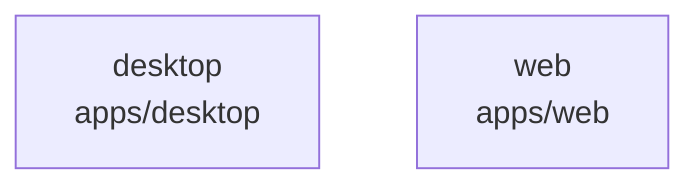

# overall-architecture/group-1/n-apps-802508

[解析トップへ戻る](../../../README.md)

確認したパス: `apps`。配下の登録ファイルは202件。

- `apps/desktop/README.md`（一覧のみ）
- `apps/desktop/local-runtime/models.json`（一覧のみ）
- `apps/desktop/local-runtime/node-entitlements.plist`（一覧のみ）
- `apps/desktop/local-runtime/setup.mjs`（一覧のみ）
- `apps/desktop/local-runtime/setup.test.mjs`（一覧のみ）
- `apps/desktop/package.json`（内容確認済み）
- `apps/desktop/src-tauri/Cargo.lock`（一覧のみ）
- `apps/desktop/src-tauri/Cargo.toml`（一覧のみ）
- `apps/desktop/src-tauri/Entitlements.plist`（一覧のみ）
- `apps/desktop/src-tauri/Info.plist`（一覧のみ）
- `apps/desktop/src-tauri/build.rs`（一覧のみ）
- `apps/desktop/src-tauri/capabilities/default.json`（一覧のみ）
- `apps/desktop/src-tauri/icons/icon.icns`（一覧のみ）
- `apps/desktop/src-tauri/icons/icon.png`（一覧のみ）
- `apps/desktop/src-tauri/src/lib.rs`（一覧のみ）
- `apps/desktop/src-tauri/src/local_setup.rs`（一覧のみ）
- `apps/desktop/src-tauri/src/main.rs`（一覧のみ）
- `apps/desktop/src-tauri/tauri.conf.json`（一覧のみ）
- `apps/web/.env.example`（一覧のみ）
- `apps/web/index.html`（一覧のみ）
- `apps/web/orb-preview.html`（一覧のみ）
- `apps/web/package.json`（内容確認済み）
- `apps/web/public/agent/runtime/index.html`（一覧のみ）
- `apps/web/public/avatar-fallbacks/sora.png`（一覧のみ）
- `apps/web/public/characters`（一覧のみ）
- `apps/web/public/demo/SOURCE.md`（一覧のみ）
- `apps/web/public/demo/voice-sample.m4a`（一覧のみ）
- `apps/web/public/icon.svg`（一覧のみ）
- `apps/web/public/robots.txt`（一覧のみ）
- `apps/web/public/sitemap.xml`（一覧のみ）
- `apps/web/public/vendor`（一覧のみ）
- `apps/web/scripts/acoustic-gate.mjs`（一覧のみ）
- `apps/web/scripts/e2e-browser.mjs`（一覧のみ）
- `apps/web/scripts/lib/make-soak-wav.mjs`（一覧のみ）
- `apps/web/scripts/lifecycle-stress.mjs`（一覧のみ）

## 要素の説明

### n-apps-desktop-27ce27

実在パス: `apps/desktop`。18ファイル。

- `apps/desktop/README.md`
- `apps/desktop/local-runtime/models.json`
- `apps/desktop/local-runtime/node-entitlements.plist`
- `apps/desktop/local-runtime/setup.mjs`
- `apps/desktop/local-runtime/setup.test.mjs`
- `apps/desktop/package.json`
- `apps/desktop/src-tauri/Cargo.lock`
- `apps/desktop/src-tauri/Cargo.toml`
- `apps/desktop/src-tauri/Entitlements.plist`
- `apps/desktop/src-tauri/Info.plist`
- `apps/desktop/src-tauri/build.rs`
- `apps/desktop/src-tauri/capabilities/default.json`
- `apps/desktop/src-tauri/icons/icon.icns`
- `apps/desktop/src-tauri/icons/icon.png`
- `apps/desktop/src-tauri/src/lib.rs`
- `apps/desktop/src-tauri/src/local_setup.rs`
- `apps/desktop/src-tauri/src/main.rs`
- `apps/desktop/src-tauri/tauri.conf.json`

### n-apps-web-8972e2

実在パス: `apps/web`。184ファイル。

- `apps/web/.env.example`
- `apps/web/index.html`
- `apps/web/orb-preview.html`
- `apps/web/package.json`
- `apps/web/public/agent/runtime/index.html`
- `apps/web/public/avatar-fallbacks/sora.png`
- `apps/web/public/characters`
- `apps/web/public/demo/SOURCE.md`
- `apps/web/public/demo/voice-sample.m4a`
- `apps/web/public/icon.svg`
- `apps/web/public/robots.txt`
- `apps/web/public/sitemap.xml`
- `apps/web/public/vendor`
- `apps/web/scripts/acoustic-gate.mjs`
- `apps/web/scripts/e2e-browser.mjs`
- `apps/web/scripts/lib/make-soak-wav.mjs`
- `apps/web/scripts/lifecycle-stress.mjs`
- `apps/web/scripts/r3-incident-e2e.mjs`
- `apps/web/scripts/screens.mjs`
- `apps/web/scripts/soak-browser.mjs`
- `apps/web/src/App.loading.test.tsx`
- `apps/web/src/App.privacy.test.tsx`
- `apps/web/src/App.projects.test.tsx`
- `apps/web/src/App.tsx`
- `apps/web/src/api/googleCalendar.oauth.test.ts`

