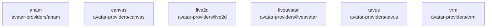

# overall-architecture/group-1/n-avatar-providers-40c65d

[解析トップへ戻る](../../../README.md)

確認したパス: `avatar-providers`。配下の登録ファイルは68件。

- `avatar-providers/anam/README.md`（一覧のみ）
- `avatar-providers/anam/package.json`（内容確認済み）
- `avatar-providers/anam/src/AnamAvatarProvider.ts`（一覧のみ）
- `avatar-providers/anam/src/anam.test.ts`（一覧のみ）
- `avatar-providers/anam/src/index.ts`（一覧のみ）
- `avatar-providers/anam/tsconfig.json`（一覧のみ）
- `avatar-providers/canvas/README.md`（一覧のみ）
- `avatar-providers/canvas/package.json`（内容確認済み）
- `avatar-providers/canvas/src/canvas.test.ts`（一覧のみ）
- `avatar-providers/canvas/src/canvasAvatar.ts`（一覧のみ）
- `avatar-providers/canvas/src/index.ts`（一覧のみ）
- `avatar-providers/canvas/tsconfig.json`（一覧のみ）
- `avatar-providers/live2d/README.md`（一覧のみ）
- `avatar-providers/live2d/demo/ab-main.ts`（一覧のみ）
- `avatar-providers/live2d/demo/ab-run.mjs`（一覧のみ）
- `avatar-providers/live2d/demo/ab.html`（一覧のみ）
- `avatar-providers/live2d/demo/index.html`（一覧のみ）
- `avatar-providers/live2d/demo/main.ts`（一覧のみ）
- `avatar-providers/live2d/demo/verify.mjs`（一覧のみ）
- `avatar-providers/live2d/demo/vite.config.ts`（一覧のみ）
- `avatar-providers/live2d/package.json`（内容確認済み）
- `avatar-providers/live2d/src/core.ts`（一覧のみ）
- `avatar-providers/live2d/src/index.ts`（一覧のみ）
- `avatar-providers/live2d/src/live2d.test.ts`（一覧のみ）
- `avatar-providers/live2d/src/live2dAvatar.ts`（一覧のみ）
- `avatar-providers/live2d/src/mapping.ts`（一覧のみ）
- `avatar-providers/live2d/src/motionSync.ts`（一覧のみ）
- `avatar-providers/live2d/src/motionsync.test.ts`（一覧のみ）
- `avatar-providers/live2d/src/motionsync/coreApi.ts`（一覧のみ）
- `avatar-providers/live2d/src/motionsync/cubismMotionSync.ts`（一覧のみ）
- `avatar-providers/live2d/src/motionsync/data.ts`（一覧のみ）
- `avatar-providers/live2d/src/motionsync/engine.ts`（一覧のみ）
- `avatar-providers/live2d/src/motionsync/index.ts`（一覧のみ）
- `avatar-providers/live2d/tsconfig.json`（一覧のみ）
- `avatar-providers/liveavatar/README.md`（一覧のみ）

## 要素の説明

### n-avatar-providers-anam-52a7e6

実在パス: `avatar-providers/anam`。6ファイル。

- `avatar-providers/anam/README.md`
- `avatar-providers/anam/package.json`
- `avatar-providers/anam/src/AnamAvatarProvider.ts`
- `avatar-providers/anam/src/anam.test.ts`
- `avatar-providers/anam/src/index.ts`
- `avatar-providers/anam/tsconfig.json`

### n-avatar-providers-canvas-2b9c7e

実在パス: `avatar-providers/canvas`。6ファイル。

- `avatar-providers/canvas/README.md`
- `avatar-providers/canvas/package.json`
- `avatar-providers/canvas/src/canvas.test.ts`
- `avatar-providers/canvas/src/canvasAvatar.ts`
- `avatar-providers/canvas/src/index.ts`
- `avatar-providers/canvas/tsconfig.json`

### n-avatar-providers-live2d-c17a08

実在パス: `avatar-providers/live2d`。22ファイル。

- `avatar-providers/live2d/README.md`
- `avatar-providers/live2d/demo/ab-main.ts`
- `avatar-providers/live2d/demo/ab-run.mjs`
- `avatar-providers/live2d/demo/ab.html`
- `avatar-providers/live2d/demo/index.html`
- `avatar-providers/live2d/demo/main.ts`
- `avatar-providers/live2d/demo/verify.mjs`
- `avatar-providers/live2d/demo/vite.config.ts`
- `avatar-providers/live2d/package.json`
- `avatar-providers/live2d/src/core.ts`
- `avatar-providers/live2d/src/index.ts`
- `avatar-providers/live2d/src/live2d.test.ts`
- `avatar-providers/live2d/src/live2dAvatar.ts`
- `avatar-providers/live2d/src/mapping.ts`
- `avatar-providers/live2d/src/motionSync.ts`
- `avatar-providers/live2d/src/motionsync.test.ts`
- `avatar-providers/live2d/src/motionsync/coreApi.ts`
- `avatar-providers/live2d/src/motionsync/cubismMotionSync.ts`
- `avatar-providers/live2d/src/motionsync/data.ts`
- `avatar-providers/live2d/src/motionsync/engine.ts`
- `avatar-providers/live2d/src/motionsync/index.ts`
- `avatar-providers/live2d/tsconfig.json`

### n-avatar-providers-liveavatar-2486af

実在パス: `avatar-providers/liveavatar`。6ファイル。

- `avatar-providers/liveavatar/README.md`
- `avatar-providers/liveavatar/package.json`
- `avatar-providers/liveavatar/src/LiveAvatarProvider.ts`
- `avatar-providers/liveavatar/src/index.ts`
- `avatar-providers/liveavatar/src/liveavatar.test.ts`
- `avatar-providers/liveavatar/tsconfig.json`

### n-avatar-providers-tavus-019d63

実在パス: `avatar-providers/tavus`。6ファイル。

- `avatar-providers/tavus/README.md`
- `avatar-providers/tavus/package.json`
- `avatar-providers/tavus/src/TavusAvatarProvider.ts`
- `avatar-providers/tavus/src/index.ts`
- `avatar-providers/tavus/src/tavus.test.ts`
- `avatar-providers/tavus/tsconfig.json`

### n-avatar-providers-vrm-2a681e

実在パス: `avatar-providers/vrm`。22ファイル。

- `avatar-providers/vrm/README.md`
- `avatar-providers/vrm/demo/index.html`
- `avatar-providers/vrm/demo/main.ts`
- `avatar-providers/vrm/demo/tsconfig.json`
- `avatar-providers/vrm/demo/vite.config.ts`
- `avatar-providers/vrm/package.json`
- `avatar-providers/vrm/src/HumanGLBAvatarProvider.ts`
- `avatar-providers/vrm/src/VRMAvatarProvider.ts`
- `avatar-providers/vrm/src/WLipSyncEngine.ts`
- `avatar-providers/vrm/src/assets.d.ts`
- `avatar-providers/vrm/src/human.test.ts`
- `avatar-providers/vrm/src/index.ts`
- `avatar-providers/vrm/src/mapping.test.ts`
- `avatar-providers/vrm/src/mapping.ts`
- `avatar-providers/vrm/src/vrm-lifecycle.test.ts`
- `avatar-providers/vrm/src/wlipsync-profile.LICENSE`
- `avatar-providers/vrm/src/wlipsync-profile.json`
- `avatar-providers/vrm/src/wlipsync.test.ts`
- `avatar-providers/vrm/src/wlipsync.worker.ts`
- `avatar-providers/vrm/src/wlipsyncCore.ts`
- `avatar-providers/vrm/src/wlipsyncProtocol.ts`
- `avatar-providers/vrm/tsconfig.json`

