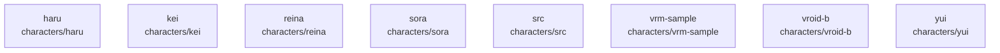

# overall-architecture/group-1/n-characters-aa908a/group-1

[解析トップへ戻る](../../../../README.md)

このグループは表示用の区切りです。独立した実行モジュールではありません。

## 要素の説明

### n-characters-haru-ea3868

実在パス: `characters/haru`。3ファイル。

- `characters/haru/character.json`
- `characters/haru/manifest.json`
- `characters/haru/model/README.md`

### n-characters-kei-b14ab4

実在パス: `characters/kei`。3ファイル。

- `characters/kei/character.json`
- `characters/kei/manifest.json`
- `characters/kei/model/README.md`

### n-characters-reina-efdb45

実在パス: `characters/reina`。3ファイル。

- `characters/reina/character.json`
- `characters/reina/manifest.json`
- `characters/reina/model/README.md`

### n-characters-sora-0f511d

実在パス: `characters/sora`。5ファイル。

- `characters/sora/LICENSE.md`
- `characters/sora/SOURCE.json`
- `characters/sora/character.json`
- `characters/sora/manifest.json`
- `characters/sora/model.glb`

### n-characters-src-cefd6f

実在パス: `characters/src`。1ファイル。

- `characters/src/index.ts`

### n-characters-vrm-sample-8ab1cb

実在パス: `characters/vrm-sample`。5ファイル。

- `characters/vrm-sample/LICENSE.md`
- `characters/vrm-sample/SOURCE.json`
- `characters/vrm-sample/character.json`
- `characters/vrm-sample/manifest.json`
- `characters/vrm-sample/model.vrm`

### n-characters-vroid-b-41cc03

実在パス: `characters/vroid-b`。6ファイル。

- `characters/vroid-b/LICENSE.md`
- `characters/vroid-b/SOURCE.json`
- `characters/vroid-b/character.json`
- `characters/vroid-b/manifest.json`
- `characters/vroid-b/model.vrm`
- `characters/vroid-b/portrait.png`

### n-characters-yui-355d04

実在パス: `characters/yui`。3ファイル。

- `characters/yui/character.json`
- `characters/yui/manifest.json`
- `characters/yui/model/README.md`

