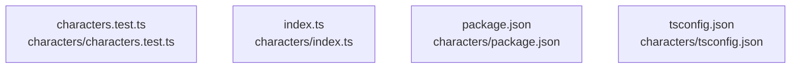

# overall-architecture/group-1/n-characters-aa908a/group-2

[解析トップへ戻る](../../../../README.md)

このグループは表示用の区切りです。独立した実行モジュールではありません。

## 要素の説明

### n-characters-characters-test-ts-7a5704

実在パス: `characters/characters.test.ts`。1ファイル。

- `characters/characters.test.ts`

### n-characters-index-ts-01778c

実在パス: `characters/index.ts`。1ファイル。

- `characters/index.ts`

### n-characters-package-json-574176

実在パス: `characters/package.json`。1ファイル。

- `characters/package.json`

### n-characters-tsconfig-json-6d49e2

実在パス: `characters/tsconfig.json`。1ファイル。

- `characters/tsconfig.json`

