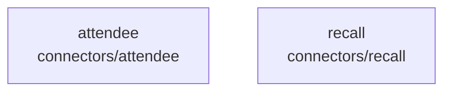

# overall-architecture/group-1/n-connectors-d84289

[解析トップへ戻る](../../../README.md)

確認したパス: `connectors`。配下の登録ファイルは17件。

- `connectors/attendee/package.json`（一覧のみ）
- `connectors/attendee/src/AttendeeConnector.ts`（一覧のみ）
- `connectors/attendee/src/attendee.test.ts`（一覧のみ）
- `connectors/attendee/src/index.ts`（一覧のみ）
- `connectors/attendee/src/protocol.ts`（一覧のみ）
- `connectors/attendee/tsconfig.json`（一覧のみ）
- `connectors/recall/fixtures/bot-status-poll.json`（一覧のみ）
- `connectors/recall/fixtures/status-webhooks.json`（一覧のみ）
- `connectors/recall/package.json`（一覧のみ）
- `connectors/recall/scripts/e2e-meet.ts`（一覧のみ）
- `connectors/recall/src/RecallConnector.ts`（一覧のみ）
- `connectors/recall/src/botPage.ts`（一覧のみ）
- `connectors/recall/src/index.ts`（一覧のみ）
- `connectors/recall/src/lifecycle.test.ts`（一覧のみ）
- `connectors/recall/src/protocol.ts`（一覧のみ）
- `connectors/recall/src/recall.test.ts`（一覧のみ）
- `connectors/recall/tsconfig.json`（一覧のみ）

## 要素の説明

### n-connectors-attendee-a7a9eb

実在パス: `connectors/attendee`。6ファイル。

- `connectors/attendee/package.json`
- `connectors/attendee/src/AttendeeConnector.ts`
- `connectors/attendee/src/attendee.test.ts`
- `connectors/attendee/src/index.ts`
- `connectors/attendee/src/protocol.ts`
- `connectors/attendee/tsconfig.json`

### n-connectors-recall-4f7f2a

実在パス: `connectors/recall`。11ファイル。

- `connectors/recall/fixtures/bot-status-poll.json`
- `connectors/recall/fixtures/status-webhooks.json`
- `connectors/recall/package.json`
- `connectors/recall/scripts/e2e-meet.ts`
- `connectors/recall/src/RecallConnector.ts`
- `connectors/recall/src/botPage.ts`
- `connectors/recall/src/index.ts`
- `connectors/recall/src/lifecycle.test.ts`
- `connectors/recall/src/protocol.ts`
- `connectors/recall/src/recall.test.ts`
- `connectors/recall/tsconfig.json`

