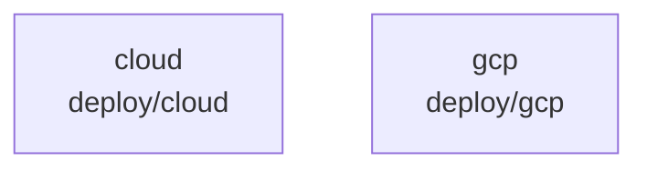

# overall-architecture/group-1/n-deploy-b0d51b

[解析トップへ戻る](../../../README.md)

確認したパス: `deploy`。配下の登録ファイルは13件。

- `deploy/cloud/.env.example`（一覧のみ）
- `deploy/cloud/Caddyfile`（一覧のみ）
- `deploy/cloud/Dockerfile`（一覧のみ）
- `deploy/cloud/Dockerfile.broker`（一覧のみ）
- `deploy/cloud/README.md`（一覧のみ）
- `deploy/cloud/budget-policy.json`（一覧のみ）
- `deploy/cloud/compose.yaml`（一覧のみ）
- `deploy/cloud/hosted-pilot.md`（一覧のみ）
- `deploy/gcp/README.md`（一覧のみ）
- `deploy/gcp/cloudbuild.broker.yaml`（一覧のみ）
- `deploy/gcp/gke/README.md`（一覧のみ）
- `deploy/gcp/team/firebase.json`（一覧のみ）
- `deploy/gcp/team/firestore.rules`（一覧のみ）

## 要素の説明

### n-deploy-cloud-5ca883

実在パス: `deploy/cloud`。8ファイル。

- `deploy/cloud/.env.example`
- `deploy/cloud/Caddyfile`
- `deploy/cloud/Dockerfile`
- `deploy/cloud/Dockerfile.broker`
- `deploy/cloud/README.md`
- `deploy/cloud/budget-policy.json`
- `deploy/cloud/compose.yaml`
- `deploy/cloud/hosted-pilot.md`

### n-deploy-gcp-566cfd

実在パス: `deploy/gcp`。5ファイル。

- `deploy/gcp/README.md`
- `deploy/gcp/cloudbuild.broker.yaml`
- `deploy/gcp/gke/README.md`
- `deploy/gcp/team/firebase.json`
- `deploy/gcp/team/firestore.rules`

