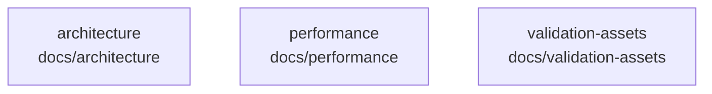

# overall-architecture/group-1/n-docs-71ab8b

[解析トップへ戻る](../../../README.md)

確認したパス: `docs`。配下の登録ファイルは49件。

- `docs/FIRST_PROOF.md`（一覧のみ）
- `docs/acceptance-gates.md`（一覧のみ）
- `docs/architecture.md`（一覧のみ）
- `docs/architecture/cloud-staged-migration.md`（一覧のみ）
- `docs/architecture/gcp-test-2026-09-08.md`（一覧のみ）
- `docs/architecture/session-modes.md`（一覧のみ）
- `docs/architecture/zoom-user-connection.md`（一覧のみ）
- `docs/audio-lifecycle.md`（一覧のみ）
- `docs/avatar-design-research.md`（一覧のみ）
- `docs/commercial-gate.md`（一覧のみ）
- `docs/conversation-benchmark.md`（一覧のみ）
- `docs/current-state.md`（一覧のみ）
- `docs/enterprise-readiness.md`（一覧のみ）
- `docs/hosted-access.md`（一覧のみ）
- `docs/human-gate.md`（一覧のみ）
- `docs/integration-contracts.md`（一覧のみ）
- `docs/live-cues.md`（一覧のみ）
- `docs/observability.md`（一覧のみ）
- `docs/oss-vrm.md`（一覧のみ）
- `docs/performance/TODO.md`（一覧のみ）
- `docs/performance/quality-first.md`（一覧のみ）
- `docs/project-continuity.md`（一覧のみ）
- `docs/site-analytics.md`（一覧のみ）
- `docs/site-intake.md`（一覧のみ）
- `docs/source-manifest.md`（一覧のみ）
- `docs/spec-v1.md`（一覧のみ）
- `docs/team-deployment.md`（一覧のみ）
- `docs/ui-design.md`（一覧のみ）
- `docs/validation-assets/avatar-refinement.json`（一覧のみ）
- `docs/validation-assets/browser-timing.json`（一覧のみ）
- `docs/validation-assets/conversation-benchmark-manifest.json`（一覧のみ）
- `docs/validation-assets/conversation-benchmark.json`（一覧のみ）
- `docs/validation-assets/conversation-timing-1.json`（一覧のみ）
- `docs/validation-assets/conversation-timing-2.json`（一覧のみ）
- `docs/validation-assets/demo-preview.gif`（一覧のみ）

## 要素の説明

### n-docs-architecture-bd3467

実在パス: `docs/architecture`。4ファイル。

- `docs/architecture/cloud-staged-migration.md`
- `docs/architecture/gcp-test-2026-09-08.md`
- `docs/architecture/session-modes.md`
- `docs/architecture/zoom-user-connection.md`

### n-docs-performance-aa866e

実在パス: `docs/performance`。2ファイル。

- `docs/performance/TODO.md`
- `docs/performance/quality-first.md`

### n-docs-validation-assets-895d30

実在パス: `docs/validation-assets`。19ファイル。

- `docs/validation-assets/avatar-refinement.json`
- `docs/validation-assets/browser-timing.json`
- `docs/validation-assets/conversation-benchmark-manifest.json`
- `docs/validation-assets/conversation-benchmark.json`
- `docs/validation-assets/conversation-timing-1.json`
- `docs/validation-assets/conversation-timing-2.json`
- `docs/validation-assets/demo-preview.gif`
- `docs/validation-assets/hosted-access.json`
- `docs/validation-assets/hosted-browser.json`
- `docs/validation-assets/portfolio-intake.json`
- `docs/validation-assets/site-intake.json`
- `docs/validation-assets/task-repeatability.json`
- `docs/validation-assets/task-workspace.json`
- `docs/validation-assets/team-cloud-first-attempt.json`
- `docs/validation-assets/team-cloud.json`
- `docs/validation-assets/team-promotion.json`
- `docs/validation-assets/team-readiness.json`
- `docs/validation-assets/vrm-local.json`
- `docs/validation-assets/vrm-local.png`

