# overall-architecture/group-1/n-packages-d8ae08/group-1

[解析トップへ戻る](../../../../README.md)

このグループは表示用の区切りです。独立した実行モジュールではありません。

```mermaid
graph TD
    n-packages-audio-core-4e5583["audio-core\npackages/audio-core"]
    n-packages-avatar-core-6a4ad5["avatar-core\npackages/avatar-core"]
    n-packages-behavior-engine-01d6b0["behavior-engine\npackages/behavior-engine"]
    n-packages-conversation-core-35c9b0["conversation-core\npackages/conversation-core"]
    n-packages-meeting-core-6d06b8["meeting-core\npackages/meeting-core"]
    n-packages-observability-1b3ff1["observability\npackages/observability"]
    n-packages-persona-core-6e0f11["persona-core\npackages/persona-core"]
    n-packages-provider-core-d4741f["provider-core\npackages/provider-core"]
```

## 要素の説明

### n-packages-audio-core-4e5583

実在パス: `packages/audio-core`。15ファイル。

- `packages/audio-core/package.json`
- `packages/audio-core/src/audio-core.test.ts`
- `packages/audio-core/src/index.ts`
- `packages/audio-core/src/lifecycle.test.ts`
- `packages/audio-core/src/metrics.ts`
- `packages/audio-core/src/mic.ts`
- `packages/audio-core/src/normalizer.ts`
- `packages/audio-core/src/pcm.ts`
- `packages/audio-core/src/resample.ts`
- `packages/audio-core/src/speaker.ts`
- `packages/audio-core/src/tap.ts`
- `packages/audio-core/src/types.ts`
- `packages/audio-core/src/vad.ts`
- `packages/audio-core/src/worklet.ts`
- `packages/audio-core/tsconfig.json`

### n-packages-avatar-core-6a4ad5

実在パス: `packages/avatar-core`。19ファイル。

- `packages/avatar-core/package.json`
- `packages/avatar-core/src/avatar-core.test.ts`
- `packages/avatar-core/src/avatarRuntime.ts`
- `packages/avatar-core/src/character.ts`
- `packages/avatar-core/src/defaultMotions.ts`
- `packages/avatar-core/src/dualRenderer.test.ts`
- `packages/avatar-core/src/dualRenderer.ts`
- `packages/avatar-core/src/expressions.ts`
- `packages/avatar-core/src/generation.test.ts`
- `packages/avatar-core/src/index.ts`
- `packages/avatar-core/src/lipsync.ts`
- `packages/avatar-core/src/motion.ts`
- `packages/avatar-core/src/motionLibrary.ts`
- `packages/avatar-core/src/motionStackAvatar.ts`
- `packages/avatar-core/src/stateMachine.ts`
- `packages/avatar-core/src/synchronizedAudioSink.test.ts`
- `packages/avatar-core/src/synchronizedAudioSink.ts`
- `packages/avatar-core/src/types.ts`
- `packages/avatar-core/tsconfig.json`

### n-packages-behavior-engine-01d6b0

実在パス: `packages/behavior-engine`。10ファイル。

- `packages/behavior-engine/package.json`
- `packages/behavior-engine/src/behavior.test.ts`
- `packages/behavior-engine/src/engine.ts`
- `packages/behavior-engine/src/index.ts`
- `packages/behavior-engine/src/listenerSemantics.ts`
- `packages/behavior-engine/src/listening.ts`
- `packages/behavior-engine/src/micro.ts`
- `packages/behavior-engine/src/planner.ts`
- `packages/behavior-engine/src/rng.ts`
- `packages/behavior-engine/tsconfig.json`

### n-packages-conversation-core-35c9b0

実在パス: `packages/conversation-core`。18ファイル。

- `packages/conversation-core/package.json`
- `packages/conversation-core/src/events.ts`
- `packages/conversation-core/src/execution.test.ts`
- `packages/conversation-core/src/execution.ts`
- `packages/conversation-core/src/generation.test.ts`
- `packages/conversation-core/src/index.ts`
- `packages/conversation-core/src/liveCues.test.ts`
- `packages/conversation-core/src/liveCues.ts`
- `packages/conversation-core/src/policy.ts`
- `packages/conversation-core/src/record.ts`
- `packages/conversation-core/src/release-policy.json`
- `packages/conversation-core/src/release.ts`
- `packages/conversation-core/src/runtime.test.ts`
- `packages/conversation-core/src/runtime.ts`
- `packages/conversation-core/src/session.ts`
- `packages/conversation-core/src/tasks.test.ts`
- `packages/conversation-core/src/tasks.ts`
- `packages/conversation-core/tsconfig.json`

### n-packages-meeting-core-6d06b8

実在パス: `packages/meeting-core`。24ファイル。

- `packages/meeting-core/package.json`
- `packages/meeting-core/src/addressDetector.ja.test.ts`
- `packages/meeting-core/src/addressDetector.live.test.ts`
- `packages/meeting-core/src/addressDetector.ts`
- `packages/meeting-core/src/botFailure.test.ts`
- `packages/meeting-core/src/botFailure.ts`
- `packages/meeting-core/src/engagement.test.ts`
- `packages/meeting-core/src/engagementState.test.ts`
- `packages/meeting-core/src/index.ts`
- `packages/meeting-core/src/lifecycle.test.ts`
- `packages/meeting-core/src/lifecycle.ts`
- `packages/meeting-core/src/liveLookup.test.ts`
- `packages/meeting-core/src/liveLookup.ts`
- `packages/meeting-core/src/meeting-core.test.ts`
- `packages/meeting-core/src/meetingPrompt.test.ts`
- `packages/meeting-core/src/meetingPrompt.ts`
- `packages/meeting-core/src/participationPolicy.default.test.ts`
- `packages/meeting-core/src/participationPolicy.open.test.ts`
- `packages/meeting-core/src/participationPolicy.ts`
- `packages/meeting-core/src/scheduling.test.ts`
- `packages/meeting-core/src/scheduling.ts`
- `packages/meeting-core/src/types.ts`
- `packages/meeting-core/src/visualTurn.test.ts`
- `packages/meeting-core/tsconfig.json`

### n-packages-observability-1b3ff1

実在パス: `packages/observability`。10ファイル。

- `packages/observability/package.json`
- `packages/observability/src/benchmark.test.ts`
- `packages/observability/src/browserTiming.test.ts`
- `packages/observability/src/index.ts`
- `packages/observability/src/observability.test.ts`
- `packages/observability/src/observer.ts`
- `packages/observability/src/stats.ts`
- `packages/observability/src/telemetry.ts`
- `packages/observability/src/types.ts`
- `packages/observability/tsconfig.json`

### n-packages-persona-core-6e0f11

実在パス: `packages/persona-core`。8ファイル。

- `packages/persona-core/package.json`
- `packages/persona-core/src/index.ts`
- `packages/persona-core/src/persona.test.ts`
- `packages/persona-core/src/persona.ts`
- `packages/persona-core/src/prompt.ts`
- `packages/persona-core/src/voices.test.ts`
- `packages/persona-core/src/voices.ts`
- `packages/persona-core/tsconfig.json`

### n-packages-provider-core-d4741f

実在パス: `packages/provider-core`。7ファイル。

- `packages/provider-core/package.json`
- `packages/provider-core/src/index.ts`
- `packages/provider-core/src/provider.ts`
- `packages/provider-core/src/router.test.ts`
- `packages/provider-core/src/router.ts`
- `packages/provider-core/src/streamingStt.ts`
- `packages/provider-core/tsconfig.json`

