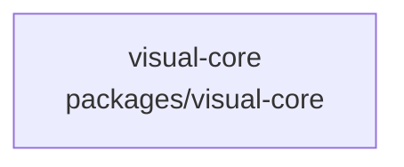

# overall-architecture/group-1/n-packages-d8ae08/group-2

[解析トップへ戻る](../../../../README.md)

このグループは表示用の区切りです。独立した実行モジュールではありません。

## 要素の説明

### n-packages-visual-core-a9abb1

実在パス: `packages/visual-core`。7ファイル。

- `packages/visual-core/package.json`
- `packages/visual-core/src/cue.ts`
- `packages/visual-core/src/gesture.ts`
- `packages/visual-core/src/index.ts`
- `packages/visual-core/src/perception.ts`
- `packages/visual-core/src/visual-core.test.ts`
- `packages/visual-core/tsconfig.json`

