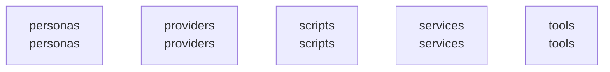

# overall-architecture/group-2

[解析トップへ戻る](../../README.md)

このグループは表示用の区切りです。独立した実行モジュールではありません。

## 要素の説明

### n-personas-709244

確認したパス: `personas`。配下の登録ファイルは23件。

- `personas/career/career_coach_ja.json`（一覧のみ）
- `personas/companion/companion_ja.json`（一覧のみ）
- `personas/english/english_beginner.json`（一覧のみ）
- `personas/english/english_business.json`（一覧のみ）
- `personas/english/english_daily.json`（一覧のみ）
- `personas/english/english_free_talk.json`（一覧のみ）
- `personas/english/english_interview.json`（一覧のみ）
- `personas/english/english_pronunciation.json`（一覧のみ）
- `personas/english/english_travel.json`（一覧のみ）
- `personas/free_talk/friend_ja.json`（一覧のみ）
- `personas/free_talk/thinking_ja.json`（一覧のみ）
- `personas/index.ts`（内容確認済み）
- `personas/interview/interviewer_en.json`（一覧のみ）
- `personas/interview/interviewer_ja.json`（一覧のみ）
- `personas/meeting/colleague_ja.json`（一覧のみ）
- `personas/package.json`（一覧のみ）
- `personas/sales/sales_customer_ja.json`（一覧のみ）
- `personas/src/catalog.ts`（一覧のみ）
- `personas/src/index.ts`（内容確認済み）
- `personas/src/personas.test.ts`（一覧のみ）
- `personas/tasks/task_organizer_ja.json`（一覧のみ）
- `personas/tsconfig.json`（一覧のみ）
- `personas/tutor/tutor_ja.json`（一覧のみ）

[詳細な図と説明を見る](n-personas-709244/README.md)

### n-providers-d7e351

確認したパス: `providers`。配下の登録ファイルは29件。

- `providers/gemini/package.json`（一覧のみ）
- `providers/gemini/src/evaluation.ts`（一覧のみ）
- `providers/gemini/src/gemini.test.ts`（一覧のみ）
- `providers/gemini/src/geminiLiveProvider.ts`（一覧のみ）
- `providers/gemini/src/index.ts`（一覧のみ）
- `providers/gemini/src/promptAdapter.ts`（一覧のみ）
- `providers/gemini/src/protocol.ts`（一覧のみ）
- `providers/gemini/src/usage.test.ts`（一覧のみ）
- `providers/gemini/src/usage.ts`（一覧のみ）
- `providers/gemini/tsconfig.json`（一覧のみ）
- `providers/local/package.json`（一覧のみ）
- `providers/local/src/evaluation.ts`（一覧のみ）
- `providers/local/src/index.ts`（一覧のみ）
- `providers/local/src/local.test.ts`（一覧のみ）
- `providers/local/src/loopback.ts`（一覧のみ）
- `providers/local/src/provider.ts`（一覧のみ）
- `providers/local/src/stt.ts`（一覧のみ）
- `providers/local/tsconfig.json`（一覧のみ）
- `providers/openai/package.json`（一覧のみ）
- `providers/openai/src/evaluation.ts`（一覧のみ）
- `providers/openai/src/events.ts`（一覧のみ）
- `providers/openai/src/index.ts`（一覧のみ）
- `providers/openai/src/live.connection.test.ts`（一覧のみ）
- `providers/openai/src/live.test.ts`（一覧のみ）
- `providers/openai/src/live.ts`（一覧のみ）
- `providers/openai/src/openai.test.ts`（一覧のみ）
- `providers/openai/src/prompt.ts`（一覧のみ）
- `providers/openai/src/provider.ts`（一覧のみ）
- `providers/openai/tsconfig.json`（一覧のみ）

[詳細な図と説明を見る](n-providers-d7e351/README.md)

### n-scripts-16728d

確認したパス: `scripts`。配下の登録ファイルは101件。

- `scripts/audit-oss-build.mjs`（一覧のみ）
- `scripts/avatar/optimize-human.mjs`（一覧のみ）
- `scripts/avatar/portrait-server.mjs`（一覧のみ）
- `scripts/avatar/portrait.html`（一覧のみ）
- `scripts/avatar/render-yui-animation.mjs`（一覧のみ）
- `scripts/avatar/render-yui-video.mjs`（一覧のみ）
- `scripts/avatar/validate-fallback.mjs`（一覧のみ）
- `scripts/avatar/validate-home.mjs`（一覧のみ）
- `scripts/avatar/validate-human.mjs`（一覧のみ）
- `scripts/avatar/validate-runtime.mjs`（一覧のみ）
- `scripts/avatar/validate-sora.mjs`（一覧のみ）
- `scripts/avatar/vrm-validation-server.mjs`（一覧のみ）
- `scripts/avatar/vrm-validation.html`（一覧のみ）
- `scripts/build-local-runtime.mjs`（一覧のみ）
- `scripts/business/site-inbox.mts`（一覧のみ）
- `scripts/cloud/budget-check.mjs`（一覧のみ）
- `scripts/cloud/gcp-deploy-broker.mjs`（一覧のみ）
- `scripts/cloud/gcp-preflight.mjs`（一覧のみ）
- `scripts/cloud/hosted-preflight.mjs`（一覧のみ）
- `scripts/cloud/promote-team.mjs`（一覧のみ）
- `scripts/cloud/team-infrastructure.mjs`（一覧のみ）
- `scripts/cloud/update-cost-snapshot.ts`（一覧のみ）
- `scripts/cloud/verify-team-release.mjs`（一覧のみ）
- `scripts/contrast-audit.mjs`（一覧のみ）
- `scripts/fetch-live2d-core.sh`（一覧のみ）
- `scripts/fetch-mediapipe.sh`（一覧のみ）
- `scripts/fetch-sample-character.sh`（一覧のみ）
- `scripts/fetch-smart-turn.sh`（一覧のみ）
- `scripts/fetch-supertonic.sh`（一覧のみ）
- `scripts/launch/README.md`（一覧のみ）
- `scripts/launch/record-demo-server.mjs`（一覧のみ）
- `scripts/launch/record-demo.html`（一覧のみ）
- `scripts/launch/record-demo.ts`（一覧のみ）
- `scripts/launch/tsconfig.json`（一覧のみ）
- `scripts/licenses.mjs`（一覧のみ）

[詳細な図と説明を見る](n-scripts-16728d/README.md)

### n-services-3e7aaa

確認したパス: `services`。配下の登録ファイルは117件。

- `services/agent/package.json`（一覧のみ）
- `services/agent/scripts/e2e-browser.mjs`（一覧のみ）
- `services/agent/scripts/e2e-local.ts`（一覧のみ）
- `services/agent/scripts/endpointing-eval.ts`（一覧のみ）
- `services/agent/scripts/stress-bargein.ts`（一覧のみ）
- `services/agent/src/adapters/llm.test.ts`（一覧のみ）
- `services/agent/src/adapters/llm.ts`（一覧のみ）
- `services/agent/src/adapters/sherpa-online.ts`（一覧のみ）
- `services/agent/src/adapters/sherpa.ts`（一覧のみ）
- `services/agent/src/adapters/stt-streaming.ts`（一覧のみ）
- `services/agent/src/adapters/stt.ts`（一覧のみ）
- `services/agent/src/adapters/tts.test.ts`（一覧のみ）
- `services/agent/src/adapters/tts.ts`（一覧のみ）
- `services/agent/src/adapters/turn.ts`（一覧のみ）
- `services/agent/src/adapters/vad.ts`（一覧のみ）
- `services/agent/src/agent.test.ts`（一覧のみ）
- `services/agent/src/config.ts`（一覧のみ）
- `services/agent/src/egress.ts`（一覧のみ）
- `services/agent/src/endpointing.test.ts`（一覧のみ）
- `services/agent/src/endpointing.ts`（一覧のみ）
- `services/agent/src/evaluation-bridge.ts`（一覧のみ）
- `services/agent/src/index.ts`（一覧のみ）
- `services/agent/src/memory.test.ts`（一覧のみ）
- `services/agent/src/memory.ts`（一覧のみ）
- `services/agent/src/planner.ts`（一覧のみ）
- `services/agent/src/protocol.ts`（一覧のみ）
- `services/agent/src/queue.ts`（一覧のみ）
- `services/agent/src/rescoreGuard.test.ts`（一覧のみ）
- `services/agent/src/rescoreGuard.ts`（一覧のみ）
- `services/agent/src/sentence.ts`（一覧のみ）
- `services/agent/src/server.ts`（一覧のみ）
- `services/agent/src/session.ts`（一覧のみ）
- `services/agent/src/wav.ts`（一覧のみ）
- `services/agent/tsconfig.json`（一覧のみ）
- `services/evaluation/package.json`（一覧のみ）

[詳細な図と説明を見る](n-services-3e7aaa/README.md)

### n-tools-0284c6

確認したパス: `tools`。配下の登録ファイルは9件。

- `tools/endpointing-corpus/.gitignore`（一覧のみ）
- `tools/endpointing-corpus/build.ts`（一覧のみ）
- `tools/endpointing-corpus/corpus.json`（一覧のみ）
- `tools/lipsync-corpus/.gitignore`（一覧のみ）
- `tools/lipsync-corpus/build.sh`（一覧のみ）
- `tools/lipsync-corpus/corpus.json`（一覧のみ）
- `tools/lipsync-corpus/offline-eval.ts`（一覧のみ）
- `tools/tts-daemon/build.sh`（一覧のみ）
- `tools/tts-daemon/main.swift`（一覧のみ）

[詳細な図と説明を見る](n-tools-0284c6/README.md)

