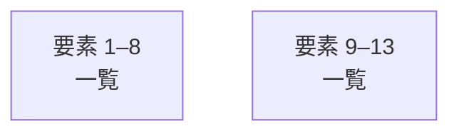

# overall-architecture/group-2/n-personas-709244

[解析トップへ戻る](../../../README.md)

確認したパス: `personas`。配下の登録ファイルは23件。

- `personas/career/career_coach_ja.json`（一覧のみ）
- `personas/companion/companion_ja.json`（一覧のみ）
- `personas/english/english_beginner.json`（一覧のみ）
- `personas/english/english_business.json`（一覧のみ）
- `personas/english/english_daily.json`（一覧のみ）
- `personas/english/english_free_talk.json`（一覧のみ）
- `personas/english/english_interview.json`（一覧のみ）
- `personas/english/english_pronunciation.json`（一覧のみ）
- `personas/english/english_travel.json`（一覧のみ）
- `personas/free_talk/friend_ja.json`（一覧のみ）
- `personas/free_talk/thinking_ja.json`（一覧のみ）
- `personas/index.ts`（内容確認済み）
- `personas/interview/interviewer_en.json`（一覧のみ）
- `personas/interview/interviewer_ja.json`（一覧のみ）
- `personas/meeting/colleague_ja.json`（一覧のみ）
- `personas/package.json`（一覧のみ）
- `personas/sales/sales_customer_ja.json`（一覧のみ）
- `personas/src/catalog.ts`（一覧のみ）
- `personas/src/index.ts`（内容確認済み）
- `personas/src/personas.test.ts`（一覧のみ）
- `personas/tasks/task_organizer_ja.json`（一覧のみ）
- `personas/tsconfig.json`（一覧のみ）
- `personas/tutor/tutor_ja.json`（一覧のみ）

## 要素の説明

### group-1

このグループは表示用の区切りです。独立した実行モジュールではありません。

[詳細な図と説明を見る](group-1/README.md)

### group-2

このグループは表示用の区切りです。独立した実行モジュールではありません。

[詳細な図と説明を見る](group-2/README.md)

