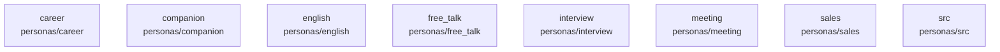

# overall-architecture/group-2/n-personas-709244/group-1

[解析トップへ戻る](../../../../README.md)

このグループは表示用の区切りです。独立した実行モジュールではありません。

## 要素の説明

### n-personas-career-f2323f

実在パス: `personas/career`。1ファイル。

- `personas/career/career_coach_ja.json`

### n-personas-companion-a053e8

実在パス: `personas/companion`。1ファイル。

- `personas/companion/companion_ja.json`

### n-personas-english-824449

実在パス: `personas/english`。7ファイル。

- `personas/english/english_beginner.json`
- `personas/english/english_business.json`
- `personas/english/english_daily.json`
- `personas/english/english_free_talk.json`
- `personas/english/english_interview.json`
- `personas/english/english_pronunciation.json`
- `personas/english/english_travel.json`

### n-personas-free-talk-056398

実在パス: `personas/free_talk`。2ファイル。

- `personas/free_talk/friend_ja.json`
- `personas/free_talk/thinking_ja.json`

### n-personas-interview-415573

実在パス: `personas/interview`。2ファイル。

- `personas/interview/interviewer_en.json`
- `personas/interview/interviewer_ja.json`

### n-personas-meeting-b1b768

実在パス: `personas/meeting`。1ファイル。

- `personas/meeting/colleague_ja.json`

### n-personas-sales-6ca36b

実在パス: `personas/sales`。1ファイル。

- `personas/sales/sales_customer_ja.json`

### n-personas-src-fd8bd1

実在パス: `personas/src`。3ファイル。

- `personas/src/catalog.ts`
- `personas/src/index.ts`
- `personas/src/personas.test.ts`

