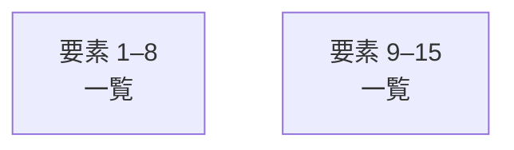

# overall-architecture/group-2/n-scripts-16728d

[解析トップへ戻る](../../../README.md)

確認したパス: `scripts`。配下の登録ファイルは101件。

- `scripts/audit-oss-build.mjs`（一覧のみ）
- `scripts/avatar/optimize-human.mjs`（一覧のみ）
- `scripts/avatar/portrait-server.mjs`（一覧のみ）
- `scripts/avatar/portrait.html`（一覧のみ）
- `scripts/avatar/render-yui-animation.mjs`（一覧のみ）
- `scripts/avatar/render-yui-video.mjs`（一覧のみ）
- `scripts/avatar/validate-fallback.mjs`（一覧のみ）
- `scripts/avatar/validate-home.mjs`（一覧のみ）
- `scripts/avatar/validate-human.mjs`（一覧のみ）
- `scripts/avatar/validate-runtime.mjs`（一覧のみ）
- `scripts/avatar/validate-sora.mjs`（一覧のみ）
- `scripts/avatar/vrm-validation-server.mjs`（一覧のみ）
- `scripts/avatar/vrm-validation.html`（一覧のみ）
- `scripts/build-local-runtime.mjs`（一覧のみ）
- `scripts/business/site-inbox.mts`（一覧のみ）
- `scripts/cloud/budget-check.mjs`（一覧のみ）
- `scripts/cloud/gcp-deploy-broker.mjs`（一覧のみ）
- `scripts/cloud/gcp-preflight.mjs`（一覧のみ）
- `scripts/cloud/hosted-preflight.mjs`（一覧のみ）
- `scripts/cloud/promote-team.mjs`（一覧のみ）
- `scripts/cloud/team-infrastructure.mjs`（一覧のみ）
- `scripts/cloud/update-cost-snapshot.ts`（一覧のみ）
- `scripts/cloud/verify-team-release.mjs`（一覧のみ）
- `scripts/contrast-audit.mjs`（一覧のみ）
- `scripts/fetch-live2d-core.sh`（一覧のみ）
- `scripts/fetch-mediapipe.sh`（一覧のみ）
- `scripts/fetch-sample-character.sh`（一覧のみ）
- `scripts/fetch-smart-turn.sh`（一覧のみ）
- `scripts/fetch-supertonic.sh`（一覧のみ）
- `scripts/launch/README.md`（一覧のみ）
- `scripts/launch/record-demo-server.mjs`（一覧のみ）
- `scripts/launch/record-demo.html`（一覧のみ）
- `scripts/launch/record-demo.ts`（一覧のみ）
- `scripts/launch/tsconfig.json`（一覧のみ）
- `scripts/licenses.mjs`（一覧のみ）

## 要素の説明

### group-1

このグループは表示用の区切りです。独立した実行モジュールではありません。

[詳細な図と説明を見る](group-1/README.md)

### group-2

このグループは表示用の区切りです。独立した実行モジュールではありません。

[詳細な図と説明を見る](group-2/README.md)

