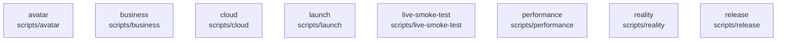

# overall-architecture/group-2/n-scripts-16728d/group-1

[解析トップへ戻る](../../../../README.md)

このグループは表示用の区切りです。独立した実行モジュールではありません。

## 要素の説明

### n-scripts-avatar-253f67

実在パス: `scripts/avatar`。12ファイル。

- `scripts/avatar/optimize-human.mjs`
- `scripts/avatar/portrait-server.mjs`
- `scripts/avatar/portrait.html`
- `scripts/avatar/render-yui-animation.mjs`
- `scripts/avatar/render-yui-video.mjs`
- `scripts/avatar/validate-fallback.mjs`
- `scripts/avatar/validate-home.mjs`
- `scripts/avatar/validate-human.mjs`
- `scripts/avatar/validate-runtime.mjs`
- `scripts/avatar/validate-sora.mjs`
- `scripts/avatar/vrm-validation-server.mjs`
- `scripts/avatar/vrm-validation.html`

### n-scripts-business-ceafd8

実在パス: `scripts/business`。1ファイル。

- `scripts/business/site-inbox.mts`

### n-scripts-cloud-451aae

実在パス: `scripts/cloud`。8ファイル。

- `scripts/cloud/budget-check.mjs`
- `scripts/cloud/gcp-deploy-broker.mjs`
- `scripts/cloud/gcp-preflight.mjs`
- `scripts/cloud/hosted-preflight.mjs`
- `scripts/cloud/promote-team.mjs`
- `scripts/cloud/team-infrastructure.mjs`
- `scripts/cloud/update-cost-snapshot.ts`
- `scripts/cloud/verify-team-release.mjs`

### n-scripts-launch-f08782

実在パス: `scripts/launch`。5ファイル。

- `scripts/launch/README.md`
- `scripts/launch/record-demo-server.mjs`
- `scripts/launch/record-demo.html`
- `scripts/launch/record-demo.ts`
- `scripts/launch/tsconfig.json`

### n-scripts-live-smoke-test-1c7f14

実在パス: `scripts/live-smoke-test`。5ファイル。

- `scripts/live-smoke-test/.gitignore`
- `scripts/live-smoke-test/README.md`
- `scripts/live-smoke-test/index.html`
- `scripts/live-smoke-test/package.json`
- `scripts/live-smoke-test/server.mjs`

### n-scripts-performance-f48045

実在パス: `scripts/performance`。1ファイル。

- `scripts/performance/assess-soak.mjs`

### n-scripts-reality-393d96

実在パス: `scripts/reality`。37ファイル。

- `scripts/reality/attendee-auto.mjs`
- `scripts/reality/attendee-human.mjs`
- `scripts/reality/attendee-selfhost/Dockerfile.arm64`
- `scripts/reality/attendee-selfhost/LICENSE.upstream`
- `scripts/reality/attendee-selfhost/MODIFICATIONS.md`
- `scripts/reality/attendee-selfhost/attendee-selfhost.sh`
- `scripts/reality/attendee-selfhost/compose.rcai.yaml`
- `scripts/reality/attendee-selfhost/local-patches.diff`
- `scripts/reality/attendee-sim.mjs`
- `scripts/reality/attendee-verify.mjs`
- `scripts/reality/cloud.mjs`
- `scripts/reality/context-window.ts`
- `scripts/reality/conversation-eval.mjs`
- `scripts/reality/converse.mjs`
- `scripts/reality/cost-ab.ts`
- `scripts/reality/gemini-conversation.ts`
- `scripts/reality/gemini-lifecycle.ts`
- `scripts/reality/human.mjs`
- `scripts/reality/lib.mjs`
- `scripts/reality/local.mjs`
- `scripts/reality/meet-human.mjs`
- `scripts/reality/meet-live.mjs`
- `scripts/reality/meet-setup.sh`
- `scripts/reality/meeting-address.mjs`
- `scripts/reality/meeting.mjs`

### n-scripts-release-003dc0

実在パス: `scripts/release`。2ファイル。

- `scripts/release/check.mjs`
- `scripts/release/reality.mjs`

