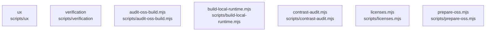

# overall-architecture/group-2/n-scripts-16728d/group-2

[解析トップへ戻る](../../../../README.md)

このグループは表示用の区切りです。独立した実行モジュールではありません。

## 要素の説明

### n-scripts-audit-oss-build-mjs-400cb9

実在パス: `scripts/audit-oss-build.mjs`。1ファイル。

- `scripts/audit-oss-build.mjs`

### n-scripts-build-local-runtime-mjs-abd3d2

実在パス: `scripts/build-local-runtime.mjs`。1ファイル。

- `scripts/build-local-runtime.mjs`

### n-scripts-contrast-audit-mjs-e07020

実在パス: `scripts/contrast-audit.mjs`。1ファイル。

- `scripts/contrast-audit.mjs`

### n-scripts-licenses-mjs-7c3b4f

実在パス: `scripts/licenses.mjs`。1ファイル。

- `scripts/licenses.mjs`

### n-scripts-prepare-oss-mjs-c4e8b0

実在パス: `scripts/prepare-oss.mjs`。1ファイル。

- `scripts/prepare-oss.mjs`

### n-scripts-ux-a68280

実在パス: `scripts/ux`。3ファイル。

- `scripts/ux/README.md`
- `scripts/ux/gate.mjs`
- `scripts/ux/local-playback.mjs`

### n-scripts-verification-4d9800

実在パス: `scripts/verification`。15ファイル。

- `scripts/verification/browser-timing.mjs`
- `scripts/verification/conversation-benchmark.mjs`
- `scripts/verification/hosted-browser.mts`
- `scripts/verification/hosted-real.mts`
- `scripts/verification/microphone-browser.mjs`
- `scripts/verification/portfolio-intake-real.mts`
- `scripts/verification/project-browser.mjs`
- `scripts/verification/record-listening-samples.mts`
- `scripts/verification/site-browser.mjs`
- `scripts/verification/site-form-delivery.mts`
- `scripts/verification/site-intake-real.mts`
- `scripts/verification/task-repeatability.mjs`
- `scripts/verification/task-workspace-browser.mjs`
- `scripts/verification/team-cloud.mts`
- `scripts/verification/team-readiness.mjs`

