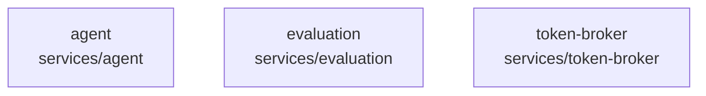

# overall-architecture/group-2/n-services-3e7aaa

[解析トップへ戻る](../../../README.md)

確認したパス: `services`。配下の登録ファイルは117件。

- `services/agent/package.json`（一覧のみ）
- `services/agent/scripts/e2e-browser.mjs`（一覧のみ）
- `services/agent/scripts/e2e-local.ts`（一覧のみ）
- `services/agent/scripts/endpointing-eval.ts`（一覧のみ）
- `services/agent/scripts/stress-bargein.ts`（一覧のみ）
- `services/agent/src/adapters/llm.test.ts`（一覧のみ）
- `services/agent/src/adapters/llm.ts`（一覧のみ）
- `services/agent/src/adapters/sherpa-online.ts`（一覧のみ）
- `services/agent/src/adapters/sherpa.ts`（一覧のみ）
- `services/agent/src/adapters/stt-streaming.ts`（一覧のみ）
- `services/agent/src/adapters/stt.ts`（一覧のみ）
- `services/agent/src/adapters/tts.test.ts`（一覧のみ）
- `services/agent/src/adapters/tts.ts`（一覧のみ）
- `services/agent/src/adapters/turn.ts`（一覧のみ）
- `services/agent/src/adapters/vad.ts`（一覧のみ）
- `services/agent/src/agent.test.ts`（一覧のみ）
- `services/agent/src/config.ts`（一覧のみ）
- `services/agent/src/egress.ts`（一覧のみ）
- `services/agent/src/endpointing.test.ts`（一覧のみ）
- `services/agent/src/endpointing.ts`（一覧のみ）
- `services/agent/src/evaluation-bridge.ts`（一覧のみ）
- `services/agent/src/index.ts`（一覧のみ）
- `services/agent/src/memory.test.ts`（一覧のみ）
- `services/agent/src/memory.ts`（一覧のみ）
- `services/agent/src/planner.ts`（一覧のみ）
- `services/agent/src/protocol.ts`（一覧のみ）
- `services/agent/src/queue.ts`（一覧のみ）
- `services/agent/src/rescoreGuard.test.ts`（一覧のみ）
- `services/agent/src/rescoreGuard.ts`（一覧のみ）
- `services/agent/src/sentence.ts`（一覧のみ）
- `services/agent/src/server.ts`（一覧のみ）
- `services/agent/src/session.ts`（一覧のみ）
- `services/agent/src/wav.ts`（一覧のみ）
- `services/agent/tsconfig.json`（一覧のみ）
- `services/evaluation/package.json`（一覧のみ）

## 要素の説明

### n-services-agent-df32b8

実在パス: `services/agent`。34ファイル。

- `services/agent/package.json`
- `services/agent/scripts/e2e-browser.mjs`
- `services/agent/scripts/e2e-local.ts`
- `services/agent/scripts/endpointing-eval.ts`
- `services/agent/scripts/stress-bargein.ts`
- `services/agent/src/adapters/llm.test.ts`
- `services/agent/src/adapters/llm.ts`
- `services/agent/src/adapters/sherpa-online.ts`
- `services/agent/src/adapters/sherpa.ts`
- `services/agent/src/adapters/stt-streaming.ts`
- `services/agent/src/adapters/stt.ts`
- `services/agent/src/adapters/tts.test.ts`
- `services/agent/src/adapters/tts.ts`
- `services/agent/src/adapters/turn.ts`
- `services/agent/src/adapters/vad.ts`
- `services/agent/src/agent.test.ts`
- `services/agent/src/config.ts`
- `services/agent/src/egress.ts`
- `services/agent/src/endpointing.test.ts`
- `services/agent/src/endpointing.ts`
- `services/agent/src/evaluation-bridge.ts`
- `services/agent/src/index.ts`
- `services/agent/src/memory.test.ts`
- `services/agent/src/memory.ts`
- `services/agent/src/planner.ts`

### n-services-evaluation-f1d0ea

実在パス: `services/evaluation`。11ファイル。

- `services/evaluation/package.json`
- `services/evaluation/src/evaluation.test.ts`
- `services/evaluation/src/evidence.ts`
- `services/evaluation/src/evidenceHeuristic.ts`
- `services/evaluation/src/heuristic.ts`
- `services/evaluation/src/index.ts`
- `services/evaluation/src/llm.ts`
- `services/evaluation/src/prompt.ts`
- `services/evaluation/src/record.ts`
- `services/evaluation/src/sidecar.ts`
- `services/evaluation/tsconfig.json`

### n-services-token-broker-c150f6

実在パス: `services/token-broker`。72ファイル。

- `services/token-broker/.env.example`
- `services/token-broker/README.md`
- `services/token-broker/package.json`
- `services/token-broker/scripts/smoke-meeting-security.ts`
- `services/token-broker/scripts/smoke-recall-webhooks.ts`
- `services/token-broker/src/app.test.ts`
- `services/token-broker/src/app.ts`
- `services/token-broker/src/env.ts`
- `services/token-broker/src/evaluation-bridge.ts`
- `services/token-broker/src/hosted-access.test.ts`
- `services/token-broker/src/hosted-access.ts`
- `services/token-broker/src/hosted-live-limits.ts`
- `services/token-broker/src/index.ts`
- `services/token-broker/src/meeting-relay.ts`
- `services/token-broker/src/meeting-session.test.ts`
- `services/token-broker/src/meeting-session.ts`
- `services/token-broker/src/meeting-ws-auth.ts`
- `services/token-broker/src/public-access.test.ts`
- `services/token-broker/src/public-access.ts`
- `services/token-broker/src/recall/balance.ts`
- `services/token-broker/src/recall/botState.test.ts`
- `services/token-broker/src/recall/botState.ts`
- `services/token-broker/src/recall/calendar.test.ts`
- `services/token-broker/src/recall/calendarBotConfig.ts`
- `services/token-broker/src/recall/calendarClient.ts`

